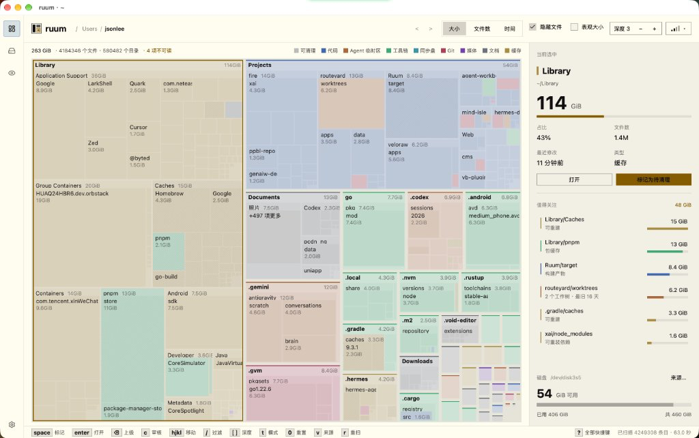

# ruum

[English](README.md) | [简体中文](README.zh.md) | [日本語](README.ja.md) | [한국어](README.ko.md)



ディスクを圧迫している原因を素早く見つけ、不要な項目をマークし、ドライブの空き容量をリアルタイムに確認しながら安全にクリーンアップできます。

**ruum** は **macOS**・**Linux**・**Windows** に対応したクロスプラットフォームのツリーマップ型ディスク解析＆クリーンアップツールです。[GPUI](https://gpui-kit.com/) と [gpui-omarchy](https://github.com/huacnlee/gpui-omarchy) で構築されており、ローカルドライブやリモート SSH サーバーを実際のディスク使用量に応じた入れ子のモザイクとして可視化します。非破壊の「マーク → 確認 → 削除」ワークフローに加え、低オーバーヘッドの**ディスク容量ウォッチドッグ**、**AI クリーンアップアシスタント**、AI エージェント向けのヘッドレス `stdio` **MCP サーバー**（`ruum mcp`）を備えています。UI と CLI はシステム言語に応じて英語・簡体字中国語（`zh`）・日本語（`ja`）・韓国語（`ko`）へ自動的にローカライズされます。

## 名前の由来：「Ruum」とは

**Ruum** という名前は、古ノルド語で**広々とした空間・開放された余白**を意味する言葉（*rúm*）に由来します。ディスク解析ツールは単にフォルダ容量の数字を並べるだけではなく、溜まったビルド成果物や古いキャッシュ、不要なファイルを一掃して、ドライブに本来のゆとりと呼吸空間を取り戻すために作られています。

---

## 目次

1. [インストールと初期設定](#インストールと初期設定)
2. [クイックスタートガイド（3 ステップで空き容量を確保）](#クイックスタートガイド3-ステップで空き容量を確保)
3. [SSH 経由のリモートサーバー分析](#ssh-経由のリモートサーバー分析)
4. [ディスク容量ウォッチドッグと AI クリーンアップアシスタント](#ディスク容量ウォッチドッグと-ai-クリーンアップアシスタント)
5. [AI エージェント向け MCP サーバー連携](#ai-エージェント向け-mcp-サーバー連携)
6. [CLI コマンドとキーボードショートカット一覧](#cli-コマンドとキーボードショートカット一覧)
7. [安全保護・計測仕様・開発ガイド](#安全保護計測仕様開発ガイド)
8. [ライセンス](#ライセンス)

---

## インストールと初期設定

### macOS

Homebrew でインストールできます（macOS 11 以降、Apple Silicon `aarch64-macos` および Intel `x86_64-macos` 対応）：

```sh
brew tap JsonLee12138/tap && brew install --cask ruum
```

または [最新リリースページ](https://github.com/JsonLee12138/Ruum/releases/latest) からインストーラーをダウンロードしてください：

- **ディスクイメージ（`.dmg`）：** `ruum-*-aarch64-macos.dmg`（または `x86_64`）を開き、`ruum.app` を `Applications` へドラッグします。
- **インストーラーパッケージ（`.pkg`）：** `ruum-*-aarch64-macos.pkg` を実行すると `/Applications/ruum.app` がインストールされ、`/usr/local/bin/ruum` がリンクされます。
- **アーカイブ（`.zip`）：** `ruum-*-aarch64-macos.zip` を展開し、`ruum.app` を `Applications` へ移動します。

**macOS 初回起動時の設定：**

1. **Gatekeeper の隔離属性を解除（未署名ビルドの場合）：** 「開発元を検証できない」または「壊れているため開けません」と表示された場合は、1 度だけ隔離属性を削除します：
   ```sh
   xattr -dr com.apple.quarantine /Applications/ruum.app
   ```
   *（または 1 回開いた後、**システム設定 › プライバシーとセキュリティ** から **このまま開く** を選択してください。）*
2. **フルディスクアクセスを許可：** メール、メッセージ、Safari、ゴミ箱、他のアプリコンテナなど保護された領域を解析するには、**システム設定 › プライバシーとセキュリティ** で **ruum** に**フルディスクアクセス**を許可してからアプリを再起動してください。読み取り不可の項目があると、右側パネルにも **プライバシー設定を開く** ボタンが表示されます。ターミナルから `ruum` を起動する場合は、そのターミナルアプリにもフルディスクアクセスが必要です。デスクトップ・書類・ダウンロードへのアクセスは初回のみ確認ダイアログが表示されます。

### Linux

[最新リリースページ](https://github.com/JsonLee12138/Ruum/releases/latest) からお使いのアーキテクチャ（`x86_64` または `aarch64`）向けのパッケージを入手してください：

- **Arch / Omarchy（AUR）：**
  ```sh
  yay -S ruum-bin   # ビルド済みリリースバイナリ
  # または：
  yay -S ruum       # ソースからビルド
  ```
- **Debian / Ubuntu（`.deb`）：** `sudo apt install ./ruum-*-x86_64-linux.deb`
- **Fedora / RHEL（`.rpm`）：** `sudo dnf install ./ruum-*-x86_64-linux.rpm`
- **AppImage：** `chmod +x ruum-*-x86_64.AppImage && ./ruum-*-x86_64.AppImage`
- **ポータブルアーカイブ（`.tar.gz`）：** `ruum-*-x86_64-linux.tar.gz` を展開し、`./install.sh` を実行します（または `ruum` を `PATH` の通ったディレクトリへコピーします）。

**Hyprland のフローティングウィンドウ設定：** Hyprland は新規ウィンドウを既定でタイリングするため、`ruum`（ウィンドウクラス `ruum`）には十分なサイズのフローティング設定を推奨します：

```ini
windowrule = float, class:^(ruum)$
windowrule = size 1400 900, class:^(ruum)$
```

### Windows

Windows 10 / 11（`x86_64` および `aarch64`）向けに [最新リリースページ](https://github.com/JsonLee12138/Ruum/releases/latest) で配布しています：

- **インストーラーウィザード（`-setup.exe`）：** `ruum-*-x86_64-windows-setup.exe` を実行します（サイレントインストール、スタートメニュー／デスクトップショートカット作成、`PATH` 登録オプションに対応）。
- **MSI パッケージ（`.msi`）：** `ruum-*-x86_64-windows.msi` でマシン全体へインストールできます（スタートメニュー登録と任意の `PATH` 設定に対応）。
- **ポータブル ZIP（`.zip`）：** `ruum-*-x86_64-windows.zip` を任意のフォルダに展開し、`ruum.exe` を実行します。

**Windows での NTFS 高速スキャン：** `--follow-links` を付けずに NTFS ドライブ全体（`C:\` など）をスキャンする場合、管理者として実行すると通常のディレクトリ走査よりも数倍高速に NTFS マスターファイルテーブル（MFT）を直接読み取り、`System Volume Information` などの保護フォルダも検査できます。一般権限で起動している場合、昇格が有効な場面では右側パネルに **管理者として再起動** ボタンが表示されます。

### ソースからのビルドとダウンロード検証

ビルドには **Rust 1.97 以降** が必要です（[rustup](https://rustup.rs) 使用時はリポジトリ直下の `rust-toolchain.toml` により自動的に切り替わります）。

- **macOS & Linux**（Linux では Vulkan 対応 GPU を備えた Wayland または X11 セッションが必要です。また、組み込み静的 SSH スキャナ用に 2 つの `musl` ターゲットを追加します）：
  ```sh
  # Linux のみ（組み込み静的 SSH ヘルパー用、C クロスコンパイラ不要）：
  rustup target add x86_64-unknown-linux-musl aarch64-unknown-linux-musl

  git clone https://github.com/JsonLee12138/Ruum.git
  cd Ruum
  make install
  ```
  - **Linux：** `make install` は `~/.local/bin/ruum`、デスクトップエントリ（既定のファイルマネージャーを変更せずディレクトリの**アプリで開く**候補に追加）、`ruum.svg` アイコンを配置します。システム全体へ入れる場合は `sudo make install PREFIX=/usr/local`、削除する場合は `make uninstall` を実行してください。
  - **macOS：** `make install` は `~/Applications/ruum.app` をビルド・配置し、`~/.local/bin/ruum` にシンボリックリンクを作成します（Xcode または Command Line Tools が必要です）。
  - `PATH` 上の古いバイナリが `~/.local/bin/ruum` より優先される場合は、シェル設定ファイルに `export PATH="$HOME/.local/bin:$PATH"` を追記してください。
- **Windows**（MSVC ツールチェーン／C++ ワークロード付き Visual Studio Build Tools が必要です）：
  ```powershell
  git clone https://github.com/JsonLee12138/Ruum.git
  cd Ruum
  cargo build --release    # target\release\ruum.exe を生成
  ```

**リリース成果物の検証：** 各リリースには `SHA256SUMS`、ファイルごとの `.sha256`、Sigstore ビルド来歴証明（attestation）が添付されます：

```sh
sha256sum -c SHA256SUMS --ignore-missing
gh attestation verify <ダウンロードしたファイル> --repo JsonLee12138/Ruum
```

### `ruum` CLI を `PATH` に登録する

`.dmg`、`.zip`、ポータブル版からデスクトップアプリをインストールした場合でも、アプリ内からワンクリックで `ruum` コマンドを登録できます：

1. **設定** を開きます（macOS は `⌘,`、Linux / Windows は `Ctrl+,`、または左端アイコンレールの歯車アイコンをクリック）。
2. **コマンドラインツール** セクションで **CLI コマンドをインストール** をクリックします（macOS の上部メニューバー **ruum › CLI コマンドをインストール…** からも実行可能）。

これにより、macOS では `/usr/local/bin/ruum`、Linux では `~/.local/bin/ruum` が登録され、Windows では `ruum.exe` が `%LOCALAPPDATA%\Programs\ruum\bin` にコピーされてユーザー環境変数 `Path` に追加されます。以降のターミナルや AI エージェントから `ruum`、`ruum ssh`、`ruum watchdog`、`ruum mcp` を直接呼び出せます。

---

## クイックスタートガイド（3 ステップで空き容量を確保）

### ステップ 1：ソースとスキャンルートを選択

1. **ruum を起動：** 引数なしで `ruum` を起動すると、ホームディレクトリ（`~`）を大きい順に即座にスキャンします。
2. **別のフォルダ・ドライブ・リモートホストを選択：** `v` を押す（または右側パネルの **ソース…**、左上の **ruum** ロゴをクリック、あるいは `ruum --choose` で起動）と **ソースとドライブ** 画面が開きます：
   - **このコンピュータ** を選ぶか、SSH ホストを入力して **SSH 接続** をクリックします。ソース一覧の取得時はマウントポイントのみを列挙し、ネットワーク共有へのアクセスやファイル走査は行いません。
   - マウント済みボリュームを選んで **選択したルートをスキャン** をクリックするか、絶対パスを入力して **ディレクトリをスキャン** をクリックします。
3. **いつでもディスク全体へ拡張：** `g` を押す、`ruum --disk` を実行する、あるいは上部パンくずリストにあるスキャンルートより上位のディレクトリ（`/` など）をクリックします。拡張スキャンは**メモ化（結果再利用）**に対応しており、`~` から `/` へ広げても既にスキャン済みのサブツリーは再利用され、`~` 以外のディレクトリのみを追加スキャンします。

### ステップ 2：ツリーマップを探索して容量圧迫要因を特定

ウィンドウ左端の**アイコンレール**から、**ツリーマップを探索**、**ソースとドライブ**、**ウォッチドッグ**、**設定** をいつでも切り替えられます。

**探索**画面の主な見方と操作：

- **ツリーマップを一目で読み解く：**
  - **タイルの面積**は実際のディスク使用量（またはファイル数）に比例します。
  - **色**はデータの種類を表します：**コード**、**エージェント作業**、**ツールチェーン**、**同期**、**Git**、**メディア**、**書類**、**キャッシュ**（未分類は中立色の **その他**）。
  - **斜線ハッチング**は **削除可能** なディレクトリ（キャッシュ、同期履歴、パッケージストア、ビルド出力、再インストール可能な依存関係、サンドボックス層、スナップショット、ゴミ箱、一時ファイル）を示します。スキャン完了前はトップレベルのリアルタイム概況を表示し、完了と同時に完全なインタラクティブツリーマップへ切り替わります。
- **上部バーの表示コントロール：**
  - **サイズ / ファイル数 / 更新日時**（`t`）：割り当てサイズ、ファイル数、最終更新日時（**今週** 〜 **それ以前** のグラデーション）を切り替えます。
  - **隠しファイル**（`i`）：ドットファイル・隠しフォルダの表示／除外を切り替えます（ホームでは `~/.cache` などが大きいため既定でオン）。
  - **見かけのサイズ**（`d`）：実際の割り当てブロック（`st_blocks × 512`）と論理ファイルサイズ（`ls -l`）を切り替えます。
  - **階層 1–6**（`[` / `]`）：同時に描画する入れ子レベル数を変更します（既定は `3`）。
  - **電源効率**：次回以降のスキャン向けに **省電力**（`miser`）、**バランス**（`balanced`）、**高パフォーマンス**（`aggressive`）、**フルパワー**（`drain-my-battery`）の各プリセットを選ぶか、CLI の `--scan-threads` でカスタムの**スキャンワーカー**数を指定できます。
- **素早い移動と絞り込み：**
  - **マウスホイール**でカーソル位置のディレクトリへ滑らかにズームし、そのまま子ディレクトリへ降りられます。逆方向に回すと上層へ戻ります。
  - `Enter` で任意の階層の選択ディレクトリを開き、`Backspace`（`⌫`）または `Esc` で 1 つ上へ戻ります。`Alt+←` / `Alt+→`（macOS は `⌘[` / `⌘]`、マウスのサイドボタンも対応）で履歴移動、矢印キーまたは `hjkl` でタイル間を移動、`Tab` で次に大きい兄弟項目へ移動できます。
  - `/` を押すと名前で絞り込みできます（一致項目のみ色が残り、`Enter` で一致のみ表示、`Esc` で解除）。
- **右側パネルで詳細と候補を確認：**
  - **選択中：** サイズ、**割合**、**ファイル数**、**最終更新**、**種類**、フックを実行しない安全な読み取り専用 **Git** 状態（未コミットの変更・スタッシュ・未プッシュコミット）、および **開く**・**削除対象にマーク** ボタンを表示します。
  - **要チェック：** 自動的に検出された大規模なキャッシュ・ビルド成果物・古いワークツリー・未更新の実験ディレクトリを優先表示します。
  - **マーク済み** & **ディスク：** マーク中の項目一覧と、削除後に回復する空き容量をリアルタイムに予測する **ディスク** バーを表示します。

### ステップ 3：マーク・確認・安全なクリーンアップ

マーク操作は**完全に非破壊**です。確認画面で実行するまで、ディスク上のファイルは一切変更されません：

1. **対象をマーク：** タイルにカーソルを合わせるか矢印キーで選択し、`Space` または `x` でマーク／解除します（macOS は `⌘`-クリック、Linux / Windows は `Ctrl`-クリックで選択フォーカスを動かさずに直接マーク可能）。親ディレクトリをマークすると内部のマークは自動統合され（**`<親>` と一緒に削除**）、削減容量が二重計上されることはありません。
2. **確認画面を開く：** `c` を押すか、右側パネル下部の **N 件のマークを確認 · … 解放…** をクリックして **確認** 画面を開きます。
3. **処理方法の選択（またはリスト／プロンプトとしてエクスポート）：**
   - **ゴミ箱へ移動**（`m`、ゴミ箱が利用可能な場合の既定）：OS のゴミ箱／ごみ箱／XDG Trash（`trash-put`、`gio trash`、組み込み XDG Trash）へ移動し、空にするまで復元できます。
   - **完全に削除**（`p`）：`rm -rf` と同様に即時削除します。実行前には**必ず対象一覧と解放容量を示す確認ダイアログが開きます**。
   - **削除せずエクスポート：** `s`（**リストを保存…**）で 1 行 1 パスのテキストを保存、または `a`（**プロンプトとしてコピー**）で安全注意事項付きの AI コーディングエージェント用プロンプトをコピーできます。
4. **実行と自動再スキャン：** `Enter`（または実行ボタン）を押すと処理が始まります。完了後、**ruum** はルートを自動で再スキャンし、**完了** 画面で処理前後に実測した**解放された容量**を表示します。

---

## SSH 経由のリモートサーバー分析

リモートファイルをダウンロードしたり誤削除したりするリスクなしにサーバー容量を調査できます：

```sh
ruum ssh dev                   # 接続してリモートマウントまたはルートを選択
ruum ssh user@server /var      # 指定したリモートディレクトリを直接スキャン
ruum ssh dev --disk            # リモートホームのあるディスク全体をスキャン
ruum ssh dev -a /srv           # /srv の見かけのサイズを計測
ruum ssh dev --check /var/log  # GUI なしでヘルパーを配置してサマリーを出力
```

アプリ内の **ソースとドライブ › SSH 接続** に SSH エイリアスまたは `user@host` を入力して接続することもできます。

### リモートスキャナの自動配置の仕組み

- **Linux パッケージビルド（`make build` / `cargo xtask portable`）：** 実行ファイル内部に静的リンクされた `x86_64` および `aarch64` `musl` 版 Linux スキャナを同梱しています。接続時にサーバーの OS と CPU アーキテクチャを判定し、キャッシュがない・一致しない場合のみ対応ヘルパーをリモートの `~/.cache/ruum/ssh/<sha256>/` へアップロードします（チェックサム検証とアトミック置換、`sudo` 不要・システムパッケージ改変なし・リモート `glibc` 非依存）。手動抽出も可能です：
  ```sh
  ruum extract-scanner x86_64 ./ruum-scan
  ruum extract-scanner aarch64 ./ruum-scan-arm64
  ```
- **開発ビルド、macOS・Windows デスクトップ版：** リモートサーバーの `PATH` または `~/.local/bin/ruum-scan` に GUI 依存のない軽量バイナリ `ruum-scan` をあらかじめインストールしてください：
  ```sh
  # リモートサーバー上のリポジトリ内で実行：
  make install-scan
  # または：
  cargo install --path crates/ruum-scan --locked
  ```
- **認証と接続の安全性：** 通常の SSH 設定・鍵・`ssh-agent` をそのまま利用します。端末起動時はパスワード／パスフレーズ入力に対応し、GUI 起動時は鍵認証・エージェントまたは SSH askpass ヘルパーを使用します。初回のみ `ssh dev` でホスト鍵を確認してください。単一の圧縮 SSH ストリーム上で上限付きレコードをストリーミングするためリモート側のメモリにツリーを保持せず、ネストされたマウントで停止し、切断時に即座に終了します。

### 読み取り専用リモート確認と安全なエクスポート手順

リモート GUI セッションは**厳格なエクスポート専用（読み取り専用）**です。ゴミ箱・完全削除ボタン、Git 状態確認、ローカルのファイルマネージャー表示は無効化され、空き容量はスキャン時点の値を表示します（`r` で再取得）：

1. ツリーマップ上で `Space` / `x` を使って対象パスをマークし、`c` で **確認** 画面を開きます。
2. エクスポート形式を選択します：
   - **プロンプトとしてコピー**（`a`）：SSH ホスト、リモート OS、スキャンルート、マークしたパス、サイズ、および削除前のホスト名・マシン ID 照合を必須とする安全指示を含めてコピーします。
   - **リストを保存…**（`s`）：リモートパスを 1 行 1 パスでローカルファイルに保存します。
   - **削除スクリプトをコピー**（`y`） / **削除スクリプトを保存…**（`e`）：「プレビュー優先」の GNU/Linux 用シェルスクリプトを生成します。引数なしで実行すると**対象の表示（プレビュー）のみ**を行い、`sh ruum-delete.sh --delete` を実行すると対象ホストへ SSH 接続して実際のカーネルホスト名とマシン ID（`HostIdentity`）がスキャン時と一致するか検証（不一致・取得不可時は即中止）したうえで、システム領域・ルート・ホーム・マウントポイント・シンボリックリンク経由のパスをすべて拒否しながら安全に処理します。

---

## ディスク容量ウォッチドッグと AI クリーンアップアシスタント

バックグラウンドで空き容量を極小オーバーヘッドで監視し（$O(1)$ の空き容量システムコールのみで、アイドル時のフォルダ走査は一切行いません）、容量がしきい値を下回った際に通知と AI によるクリーンアップ提案を生成します。

### 1. ウォッチドッグと OS バックグラウンドサービスの設定

**設定** 画面（macOS は `⌘,`、Linux / Windows は `Ctrl+,`）を開きます：

1. **ウォッチドッグの空き容量監視を有効にする** をオンにします。
2. **ログイン時に OS バックグラウンドサービスとして実行 (launchd / systemd / Windows)** をオンにしてネイティブ常駐サービスを登録します：
   - **macOS：** `launchd` ユーザーエージェント（`com.ruum.watchdog`）
   - **Linux：** `systemd --user` サービス（`ruum-watchdog.service`）
   - **Windows：** UAC プロンプトなしの `HKCU\Software\Microsoft\Windows\CurrentVersion\Run` 登録＋非表示バックグラウンドプロセス（`CREATE_NO_WINDOW`）
   *（端末から直接 `ruum watchdog` で常駐実行、または `ruum watchdog --once` で 1 回のみチェックすることもできます。）*
3. しきい値と間隔を調整します：
   - **最小空き容量しきい値 (GB)：** 既定 `20` GB（最小 `1` GB）。
   - **チェック間隔（分）：** 既定 `5` 分（最小 `30` 秒）。
   - **再通知クールダウン（最小 5 分）：** 既定 `360` 分／6 時間（最小 `5` 分）。
4. 容量不足時に自動で提案を作成したい場合は **空き容量不足時に AI 分析を自動実行する** をオンにします。
5. **設定を保存** をクリックします。

### 2. AI アシスタント CLI の設定

同じく **設定** 画面の **AI アシスタント CLI** セクションで設定します：

1. プロバイダープリセットから **Agy**、**Pi**、**Codex**、または **カスタム**（**カスタム実行コマンド / パス**・**カスタム追加引数**）を選びます。
2. 必要に応じて **モデル指定（任意）** を入力し、**CLI 接続をテスト** でコマンド疎通を確認するか、**モデル一覧を取得** をクリックして各モデル（または **すべてのモデルの速度をテスト**）の応答速度を計測し、最適なモデルを選択します。
3. **設定を保存** をクリックします。

### 3. AI クリーンアップ提案の確認と承認

- 左アイコンレールの **ウォッチドッグ**（またはシステムトレイ／メニューバーアイコン）から、**ボリューム状態** の確認、**今すぐディスク空き容量を確認**、**今すぐ AI 分析を実行**、提案生成後の **確認して承認…**（トレイからは **最新の提案を確認…**）を実行できます。
- **承認なしで自動削除されることは絶対にありません。** すべての AI 提案は独立した **ruum · クリーンアップの確認** ウィンドウ（`ruum --confirm-cleanup ...`）で開きます：
  - 各候補の読み取り専用削除モード表示（**ゴミ箱** / **完全削除**）、パス、バイトサイズ、削除理由、ローカル Git の未コミット／未プッシュ警告を確認します。
  - **すべて選択** / **選択解除** や個別のチェックボックスで、残す項目と削除する項目を選びます。
  - **確認して削除** をクリックすると実行され、**キャンセル** またはウィンドウを閉じると何も変更せず中止します。
- *トレイ常駐について：* システムトレイ／メニューバーアイコンが有効な場合、メインウィンドウを閉じてもウォッチドッグ用にバックグラウンドで静かに待機し続けます。完全に終了するには `⌘Q` / `Ctrl+Q`（または探索画面で `q`）を押すか、トレイメニューの **Ruum を終了** を選択してください。

---

## AI エージェント向け MCP サーバー連携

**ruum** には GUI を起動せず `stdout` を純粋なプロトコル出力専用に保つヘッドレスの Model Context Protocol（`stdio` JSON-RPC 2.0）サーバー（`ruum mcp`）が内蔵されています。

### MCP クライアントの設定

あらかじめ **設定 › コマンドラインツール › CLI コマンドをインストール** で `ruum` を `PATH` に登録したうえで、MCP クライアント設定に以下を追加します：

```json
{
  "mcpServers": {
    "ruum": {
      "command": "ruum",
      "args": ["mcp"]
    }
  }
}
```

削除系ツールを一切無効化し、読み取り専用の調査と削除計画のみを許可する場合は `--read-only` を指定します：

```json
{
  "mcpServers": {
    "ruum": {
      "command": "ruum",
      "args": ["mcp", "--read-only"]
    }
  }
}
```

### 提供される 8 つの MCP ツール

| ツール名 | 対象範囲 | 主な引数 | 安全境界 |
| --- | --- | --- | --- |
| `list_volumes` | ローカル / SSH | `ssh_host?` | 読み取り専用のマウント検出（ファイル走査なし） |
| `scan_directory` | ローカル / SSH | `path?`, `disk?`, `ssh_host?`, `apparent_size?`, `include_hidden?`, `max_entries?`, `rescan?` | 読み取り専用スキャン（セッション内キャッシュあり） |
| `inspect_subtree` | ローカル / SSH | `root`, `subpath?`, `filter?`, `ssh_host?`, `max_entries?` | 読み取り専用のサブツリー閲覧および部分一致検索 |
| `find_reclaimable` | ローカル / SSH | `root`, `ssh_host?`, `limit?` | キャッシュ・ビルド出力・ワークツリー等の読み取り専用ヒューリスティック検出 |
| `check_git_safety` | ローカルのみ | `paths`（文字列配列） | フック無効・読み取り専用の Git 状態検査（`ssh_host` 指定は拒否） |
| `plan_removal` | ローカル / SSH | `root`, `targets`（配列）, `ssh_host?` | `removal` ガードに対するドライラン検証（削除は一切行わない） |
| `trash_paths` | ローカル / SSH | `root`, `targets`（配列）, `ssh_host?` | `--read-only` 時は無効；**GUI 確認画面でのチェックボックス承認が必須** |
| `delete_permanently` | ローカルのみ | `root`, `targets`（配列）, `reason?` | `--read-only` 時は無効・`ssh_host` 禁止；**GUI チェックボックス承認＋OS ネイティブ認証（Touch ID 等）が必須** |

確認ダイアログまたは OS ネイティブ認証が失敗・タイムアウトした場合、あるいは対話的なデスクトップセッションが存在しない場合は **Fail-Closed（失敗時は必ず拒否）** として動作し、ファイルは一切削除されません。

---

## CLI コマンドとキーボードショートカット一覧

### CLI コマンドとオプション

```sh
ruum [オプション] [PATH]                # PATH をスキャン（省略時は ~）
ruum ssh HOST [オプション] [PATH]       # SSH 経由でリモートホストを分析（読み取り専用）
ruum mcp [--read-only]                 # stdio MCP サーバーを起動
ruum watchdog [--once]                 # ウォッチドッグ常駐監視（または単発チェック）
ruum extract-scanner ARCH OUTPUT       # 同梱の静的 Linux スキャナを抽出（x86_64 | aarch64）
```

| フラグ | 説明 |
| --- | --- |
| `--choose` | スキャン前に **ソースとドライブ** 選択画面を開く |
| `-a`, `--apparent-size` | 割り当てブロックではなく見かけのファイルサイズを計測 |
| `-l`, `--follow-links` | シンボリックリンクを辿る（ローカルスキャンのみ） |
| `-H`, `--no-hidden` | ドットファイル・ドットディレクトリをスキップ |
| `-D`, `--disk` | ホームディレクトリがあるディスク全体をスキャン |
| `-X`, `--cross-filesystems` | `PATH` 配下にマウントされた別ディスク・ネットワーク共有・仮想ファイルシステムも計測（ローカルのみ・既定オフ） |
| `-d`, `--depth N` | 初期描画する階層数（`1`–`6`、既定 `3`） |
| `--power-efficiency PRESET` | 電源効率プリセット：`miser`、`balanced`（既定）、`aggressive`、`drain-my-battery` |
| `--scan-threads N` | スキャンワーカー数を固定（利用可能 CPU 数が上限） |
| `--adaptive-threads` | 実験的な適応型スレッド制御を有効化 |
| `--fixed-threads` | 適応型制御と CPU 上限を無効化 |
| `--thread-throughput-percent N` | 初期スループットの維持目標パーセント（既定 `80`） |
| `--thread-system-cpu-percent N` | ホスト CPU 使用率上限パーセント（`0` で無効、既定 `80`） |
| `--metric files\|bytes` | バイト数（`bytes`）ではなくファイル数（`files`）でタイルを順位付け |
| `--open-screen SCREEN` | 指定画面を直接開いて起動（`explore`、`sources`、`watchdog`、`settings`） |
| `--check` | `ssh` と併用：ウィンドウを開かずにヘルパー配置とスキャンサマリー出力を実行 |
| `-h`, `--help` | ローカライズされた CLI ヘルプを表示 |

### キーボード＆マウスショートカット — 探索画面

| キー / 操作 | 動作 |
| --- | --- |
| `Space` / `x` | 指している／選択中のタイルをマーク／解除 |
| `Ctrl`-クリック（macOS は `⌘`-クリック） | 選択を移動せずにマーク／解除 |
| `Enter` | 選択したディレクトリを任意の階層から開く |
| `Backspace`（`⌫`） / `Esc` / `u` | 1 つ上のディレクトリへ戻る（フィルタ／スキャン／選択解除が優先される場合を除く） |
| `Alt+←` / `Alt+→`（macOS は `⌘[` / `⌘]`、マウスサイドボタン） | 閲覧履歴の戻る／進む |
| `←` `↑` `↓` `→` / `h` `j` `k` `l` | 現在の階層のタイル間を移動 |
| `Tab` / `Shift+Tab` | 次／前の大きい兄弟項目へ移動 |
| スクロールホイール | ディレクトリ方向へズームし、そのまま内部へ移動 |
| `Shift`-スクロール | 拡大表示中のツリーマップをパン移動 |
| `[` / `]` | 一度に表示する階層数を増減（`1`–`6`） |
| `-` / `=`（`+`） / `0` | 表示の縮小・拡大・リセット |
| `Ctrl`（macOS は `⌘`）+ `=` / `-` / `0` | インターフェース全体の拡大率を変更 |
| `/`（または `s`） | 名前で絞り込み（`Enter` で一致のみ表示、`Esc` でクリア） |
| `c` | マーク済みリストの **確認** 画面を開く |
| `t` | **サイズ**・**ファイル数**・**更新日時** モードを切り替え |
| `d` | **ディスク使用量** と **見かけのサイズ** を切り替え |
| `i` | **隠しファイル** の含有／除外を切り替え |
| `r` / `Ctrl+R`（macOS は `⌘R`） / `F5` | 同じルートから再スキャン |
| `Esc`（スキャン中） | 実行中のスキャンを中止 |
| `v` | **ソースとドライブ** を開く |
| `Ctrl+O`（macOS は `⌘O`） | 別のローカルディレクトリを選択してスキャン |
| `g` | ディスク全体をスキャン（またはパンくずの親階層をクリックして拡張） |
| `p` | 選択詳細パネルを表示／非表示 |
| `o` / `Ctrl+Shift+R`（`⌘⇧R`） / 右クリック | Finder、エクスプローラー、またはファイルマネージャーで表示 |
| `Ctrl+,`（macOS は `⌘,`） | **設定** 画面を開く |
| `?` | キーボードとマウスのヘルプ一覧を表示／非表示 |
| `q` / `Ctrl+Q`（macOS は `⌘Q`） | ruum を終了（`Ctrl+W` / `⌘W` はアクティブウィンドウを閉じる） |

### キーボードショートカット — 確認画面

| キー | 動作 |
| --- | --- |
| `m` | **ゴミ箱へ移動** を選択（ローカルのみ） |
| `p` | **完全に削除** を選択（ローカルのみ） |
| `!` | すべてのマークを解除 |
| `s` | **リストを保存…**（1 行 1 パス） |
| `a` | コーディングエージェント向けに **プロンプトとしてコピー** |
| `y` / `e` | **削除スクリプトをコピー** / **削除スクリプトを保存…**（シェルやリモート SSH 確認向けのプレビュー優先 GNU/Linux シェルスクリプトを出力） |
| `Enter` | 選択した削除方式を実行（ローカルのみ；完全削除は常に確認ダイアログを表示） |
| `Esc` | **探索** 画面へ戻る |

---

## 安全保護・計測仕様・開発ガイド

### 組み込み削除ガードと読み取り専用 Git チェック

すべての削除保護ルールは `crates/ruum-core/src/removal.rs` に実装され、実ディレクトリツリーを用いたテストで検証されています：

- 現在のスキャンルート**配下**のパスのみ削除対象として許可されます。
- ファイルシステムのルート、スキャンルート自身、ホームディレクトリ、およびホームディレクトリやシステム領域を含む祖先ディレクトリは常に拒否されます。
- マウントポイントおよび内部にマウントポイントを含むディレクトリは拒否され、完全削除はマウント境界を越えません。
- 書き込み可能であっても、保護された OS・パッケージマネージャー領域（`/usr`、`/etc`、`/boot`、`/var/lib`、`/nix/store`、`/gnu/store`、Homebrew プレフィックスなど）は拒否されます。
- Windows では `Windows`、`Program Files`、`ProgramData`、`System Volume Information`、`Recovery`、`Boot`、ページ／休止状態ファイル、およびユーザープロファイル直下のフォルダ（`FOLDERID_UserProfiles`、例：`C:\Users\*`）が拒否されます（プロファイル内部のサブディレクトリはクリーンアップ可能）。
- シンボリックリンクはリンク先を辿らずリンク自体のみを解除し、パスがシェル経由で文字列展開されることもありません（`-rf` という名前のファイルも安全に 1 ファイル名として扱われます）。
- Git 状態の検査は fsmonitor・フック・ページャーを無効化して読み取り専用で実行され、カスタム filter driver が設定されたリポジトリは評価せずスキップします。

### ディスク容量の計測仕様とプラットフォーム差異

- **割り当てブロック vs 見かけのサイズ：** 既定値は `st_blocks × 512`（Unix）および NTFS クラスタ割り当て量（Windows）であり、実際に削除して戻る容量と一致します。
- **ハードリンクの重複排除：** 同一 inode への複数ハードリンクは、ボトムアップのツリー集計時に 1 回のみ加算されます。
- **1 ボリューム単位の空き容量予測：** ネストされたマウント（Linux の bind mount や同一デバイスの `btrfs` サブボリュームを含む）は既定でスキップされます。ローカルで `-X` を有効にした場合でも、別ボリューム上のマークは現在のボリュームの空き容量予測バーから除外され、パネルに明記されます。
- **macOS 固有仕様：** 空き容量は `df` と一致します（Finder の「パージ可能領域」は含みません）。APFS クローンファイルはブロックを共有するため 1 つ削除しても表示ほど空きが増えない場合があります。Time Machine のローカルスナップショットは走査から除外され、クラウド退避済みファイル（iCloud Drive、Dropbox 等）は開いたりダウンロードを発火させたりしません。

### 開発コマンドとリポジトリ構成

```sh
make run       # Release ビルドして「ソースとドライブ」を起動
make lint      # rustfmt --check + clippy --all-targets -D warnings
make test      # コア単体・実ファイルテスト + GPUI ウィンドウハーネステスト
make test-ssh  # ローカルホストでの実 SSH テスト（Linux、要 bun + openssh）
make ci        # lint に続けて test を実行
```

Windows では `cargo xtask lint`、`cargo xtask test`、`cargo build --release` を直接実行してください。

| パス | 役割 |
| --- | --- |
| `crates/ruum-core` | スキャン、ツリー集計、Squarified レイアウト、容量計算、削除ガード、ウォッチドッグ、AI CLI、SSH、MCP |
| `crates/ruum-scan` | GUI 依存なしの軽量ヘッドレスリモート SSH スキャナバイナリ |
| `crates/ruum-app` | GPUI デスクトップ UI、状態・キーバインド、多言語対応（`en`/`zh`/`ja`/`ko`）、トレイ、ウィンドウテスト |
| `xtask/`, `packaging/`, `assets/` | リリースバンドル、クロスプラットフォームインストーラー、アイコン、デスクトップエントリテンプレート |

---

## ライセンス

`GPL-3.0-only` — [LICENSE](LICENSE) を参照してください。上流の `disktree` / `ruum` に由来するコードには MIT ライセンスに基づく帰属表示が含まれます（[THIRD_PARTY_NOTICES.md](THIRD_PARTY_NOTICES.md)）。
