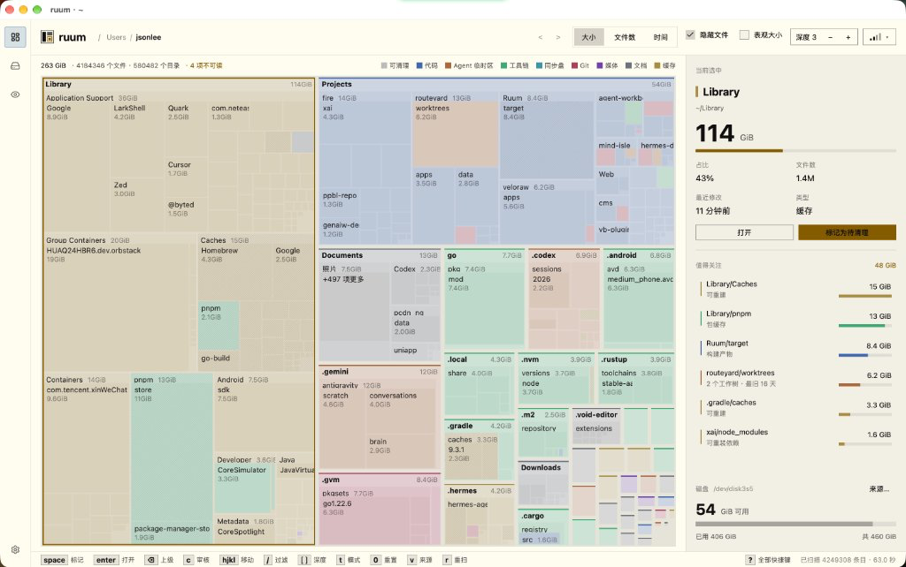

# ruum

[English](README.md) | [简体中文](README.zh.md) | [日本語](README.ja.md) | [한국어](README.ko.md)



디스크 공간을 차지하는 주범을 빠르게 찾아 표시하고, 볼륨의 여유 공간을 화면에 실시간으로 띄워 둔 채 안전하게 정리하세요.

**ruum**은 **macOS**, **Linux**, **Windows**를 지원하는 크로스 플랫폼 트리맵 디스크 분석 및 안전 정리 도구입니다. [GPUI](https://gpui-kit.com/)와 [gpui-omarchy](https://github.com/huacnlee/gpui-omarchy)로 제작되어 로컬 드라이브와 원격 SSH 서버를 실제 디스크 사용량에 비례하는 중첩 모자이크로 시각화하며, 비파괴적인 '표시 → 검토 → 정리' 워크플로와 함께 저부하 **디스크 공간 워치독**, **AI 정리 어시스턴트**, AI 에이전트용 헤드리스 `stdio` **MCP 서버**(`ruum mcp`)를 제공합니다. UI와 CLI는 시스템 언어에 따라 영어, 중국어 간체(`zh`), 일본어(`ja`), 한국어(`ko`)로 자동 현지화됩니다.

## 이름의 유래: 왜 "Ruum"인가요?

**Ruum**은 고대 노르드어에서 **넓고 탁 트인 공간·여유 공간**을 뜻하는 단어(*rúm*)에서 유래했습니다. 디스크 분석기는 단순히 복잡한 용량 숫자를 나열하는 도구가 아니라, 쌓인 빌드 산출물과 오래된 캐시, 불필요한 파일을 치워 드라이브에 숨 쉴 수 있는 넉넉한 공간을 되돌려주기 위해 만들어졌습니다.

---

## 목차

1. [설치 및 초기 설정](#설치-및-초기-설정)
2. [빠른 시작 튜토리얼 (3단계로 디스크 공간 확보하기)](#빠른-시작-튜토리얼-3단계로-디스크-공간-확보하기)
3. [SSH를 통한 원격 서버 분석](#ssh를-통한-원격-서버-분석)
4. [디스크 공간 워치독 및 AI 정리 어시스턴트](#디스크-공간-워치독-및-ai-정리-어시스턴트)
5. [AI 에이전트를 위한 MCP 서버 연동](#ai-에이전트를-위한-mcp-서버-연동)
6. [CLI 명령어 및 단축키 참조](#cli-명령어-및-단축키-참조)
7. [안전 보호 장치, 측정 방식 및 개발 안내](#안전-보호-장치-측정-방식-및-개발-안내)
8. [라이선스](#라이선스)

---

## 설치 및 초기 설정

### macOS

Homebrew로 설치할 수 있습니다(macOS 11 이상, Apple Silicon `aarch64-macos` 및 Intel `x86_64-macos` 지원):

```sh
brew tap JsonLee12138/tap && brew install --cask ruum
```

또는 [최신 릴리스 페이지](https://github.com/JsonLee12138/Ruum/releases/latest)에서 설치 파일을 내려받으세요:

- **디스크 이미지(`.dmg`):** `ruum-*-aarch64-macos.dmg`(또는 `x86_64`)를 열고 `ruum.app`을 `Applications`로 드래그합니다.
- **설치 패키지(`.pkg`):** `ruum-*-aarch64-macos.pkg`를 실행하면 `/Applications/ruum.app`이 설치되고 `/usr/local/bin/ruum`이 연결됩니다.
- **압축 파일(`.zip`):** `ruum-*-aarch64-macos.zip`의 압축을 풀고 `ruum.app`을 `Applications`로 옮깁니다.

**macOS 최초 실행 설정:**

1. **Gatekeeper 격리 속성 해제(서명되지 않은 빌드):** 개발자를 확인할 수 없거나 손상되었다는 경고가 나타나면 한 번만 격리 속성을 제거하세요:
   ```sh
   xattr -dr com.apple.quarantine /Applications/ruum.app
   ```
   *(또는 한 번 실행을 시도한 뒤 **시스템 설정 › 개인정보 보호 및 보안**에서 **확인 없이 열기**를 선택하세요.)*
2. **전체 디스크 접근 권한 부여:** Mail, 메시지, Safari, 휴지통, 다른 앱 컨테이너 등 보호된 위치를 검사하려면 **시스템 설정 › 개인정보 보호 및 보안**에서 **ruum**에 **전체 디스크 접근 권한**을 허용한 뒤 앱을 다시 실행하세요. 읽을 수 없는 항목이 있으면 오른쪽 패널에도 **개인정보 보호 설정 열기** 버튼이 표시됩니다. 터미널에서 `ruum`을 실행하는 경우에는 해당 터미널 앱에도 권한이 필요합니다. 데스크톱·문서·다운로드 폴더는 처음 접근할 때 한 번만 별도 권한을 요청합니다.

### Linux

[최신 릴리스 페이지](https://github.com/JsonLee12138/Ruum/releases/latest)에서 아키텍처(`x86_64` 또는 `aarch64`)에 맞는 패키지를 내려받으세요:

- **Arch / Omarchy (AUR):**
  ```sh
  yay -S ruum-bin   # 사전 빌드된 릴리스 바이너리
  # 또는:
  yay -S ruum       # 소스에서 직접 빌드
  ```
- **Debian / Ubuntu (`.deb`):** `sudo apt install ./ruum-*-x86_64-linux.deb`
- **Fedora / RHEL (`.rpm`):** `sudo dnf install ./ruum-*-x86_64-linux.rpm`
- **AppImage:** `chmod +x ruum-*-x86_64.AppImage && ./ruum-*-x86_64.AppImage`
- **포터블 압축 파일(`.tar.gz`):** `ruum-*-x86_64-linux.tar.gz`를 풀고 `./install.sh`를 실행하거나 `ruum`을 `PATH` 경로에 복사합니다.

**Hyprland 플로팅 창 규칙:** Hyprland는 기본적으로 새 창을 타일링하므로 `ruum`(창 클래스 `ruum`)에 넉넉한 플로팅 창 규칙을 지정하는 것을 권장합니다:

```ini
windowrule = float, class:^(ruum)$
windowrule = size 1400 900, class:^(ruum)$
```

### Windows

Windows 10 및 11(`x86_64`, `aarch64`)용 파일은 [최신 릴리스 페이지](https://github.com/JsonLee12138/Ruum/releases/latest)에서 받을 수 있습니다:

- **설치 마법사(`-setup.exe`):** `ruum-*-x86_64-windows-setup.exe`를 실행합니다(무인 설치, 시작 메뉴/바탕 화면 바로 가기 및 선택적 `PATH` 등록 지원).
- **MSI 패키지(`.msi`):** `ruum-*-x86_64-windows.msi`로 시스템 전체 설치 및 시작 메뉴 바로 가기, `PATH` 옵션을 구성합니다.
- **포터블 압축 파일(`.zip`):** `ruum-*-x86_64-windows.zip`을 원하는 폴더에 풀고 `ruum.exe`를 실행합니다.

**Windows 고속 NTFS 스캔:** `--follow-links` 없이 전체 NTFS 드라이브(예: `C:\`)를 스캔할 때 관리자 권한으로 실행하면 일반 디렉터리 순회보다 몇 배 빠르게 NTFS 마스터 파일 테이블(MFT)을 직접 읽고 `System Volume Information` 같은 보호 폴더도 검사할 수 있습니다. 일반 권한에서 권한 상승이 도움이 되는 경우 오른쪽 패널에 **관리자 권한으로 다시 시작** 버튼이 표시됩니다.

### 소스에서 빌드 및 다운로드 검증

소스 빌드에는 **Rust 1.97 이상**이 필요합니다([rustup](https://rustup.rs) 환경에서는 루트의 `rust-toolchain.toml` 버전이 자동 적용됩니다).

- **macOS & Linux**(Linux는 Vulkan 지원 GPU가 있는 Wayland/X11 세션이 필요하며, 내장 정적 SSH 스캐너 빌드를 위해 두 `musl` 타깃을 추가합니다):
  ```sh
  # Linux 전용 (내장 정적 SSH 도우미 빌드용, 별도 C 크로스 컴파일러 불필요):
  rustup target add x86_64-unknown-linux-musl aarch64-unknown-linux-musl

  git clone https://github.com/JsonLee12138/Ruum.git
  cd Ruum
  make install
  ```
  - **Linux:** `make install`은 `~/.local/bin/ruum`, 데스크톱 항목(기본 파일 관리자를 바꾸지 않고 디렉터리의 **다른 프로그램으로 열기** 항목 추가), `ruum.svg` 아이콘을 설치합니다. 시스템 전역 설치는 `sudo make install PREFIX=/usr/local`, 제거는 `make uninstall`을 사용하세요.
  - **macOS:** `make install`은 `~/Applications/ruum.app`을 빌드·설치하고 `~/.local/bin/ruum`에 심볼릭 링크를 만듭니다(Xcode 또는 Command Line Tools 필요).
  - `PATH` 앞부분의 구버전이 `~/.local/bin/ruum`을 가리는 경우 셸 설정에 `export PATH="$HOME/.local/bin:$PATH"`를 추가하세요.
- **Windows**(C++ 워크로드가 포함된 MSVC 도구 모음 / Visual Studio Build Tools 필요):
  ```powershell
  git clone https://github.com/JsonLee12138/Ruum.git
  cd Ruum
  cargo build --release    # target\release\ruum.exe 생성
  ```

**릴리스 아티팩트 검증:** 모든 릴리스에는 `SHA256SUMS`, 개별 `.sha256` 파일, Sigstore 빌드 출처 증명(attestation)이 함께 제공됩니다:

```sh
sha256sum -c SHA256SUMS --ignore-missing
gh attestation verify <다운로드한-파일> --repo JsonLee12138/Ruum
```

### `PATH`에 `ruum` CLI 등록하기

`.dmg`, `.zip`, 포터블 압축 파일로 데스크톱 앱을 설치한 경우 앱 안에서 한 번의 클릭으로 터미널 명령을 등록할 수 있습니다:

1. **설정**을 엽니다(macOS는 `⌘,`, Linux/Windows는 `Ctrl+,`, 또는 왼쪽 아이콘 레일의 톱니바퀴 아이콘 클릭).
2. **명령줄 도구** 항목에서 **CLI 명령 설치**를 클릭합니다(macOS 상단 메뉴 바의 **ruum › CLI 명령 설치…**에서도 실행 가능).

실행하면 macOS는 `/usr/local/bin/ruum`, Linux는 `~/.local/bin/ruum`에 연결하고, Windows는 `ruum.exe`를 `%LOCALAPPDATA%\Programs\ruum\bin`에 복사한 뒤 사용자 `Path`에 등록하여 어떤 터미널이나 AI 에이전트에서도 `ruum`, `ruum ssh`, `ruum watchdog`, `ruum mcp`를 바로 사용할 수 있게 됩니다.

---

## 빠른 시작 튜토리얼 (3단계로 디스크 공간 확보하기)

### 1단계: 소스 및 스캔 루트 선택하기

1. **ruum 실행:** 별도 인수 없이 `ruum`을 실행하면 홈 디렉터리(`~`)를 큰 항목부터 즉시 스캔합니다.
2. **다른 폴더, 드라이브 또는 원격 호스트 선택:** `v`를 누르거나(또는 오른쪽 패널의 **소스…**, 왼쪽 상단 **ruum** 로고 클릭, 또는 `ruum --choose` 실행) **소스 및 드라이브** 화면을 엽니다:
   - **이 컴퓨터**를 선택하거나 SSH 대상을 입력한 뒤 **SSH 연결**을 클릭합니다. 소스 탐색은 네트워크 공유를 탐색하거나 파일을 스캔하지 않고 마운트 목록만 읽어옵니다.
   - 마운트된 볼륨을 선택하고 **선택한 루트 스캔**을 클릭하거나, 절대 경로를 입력한 뒤 **디렉터리 스캔**을 클릭합니다.
3. **언제든 전체 디스크로 확장:** `g`를 누르거나 `ruum --disk`로 실행하거나, 상단 경로 표시줄에서 스캔 루트 위쪽의 상위 경로(예: `/`)를 클릭하세요. 범위 확장은 **메모이제이션(결과 재사용)**을 지원하므로 `~`에서 `/`로 넓히더라도 이미 스캔한 하위 트리는 재사용하고 `~` 바깥의 디렉터리만 추가로 읽습니다.

### 2단계: 트리맵 탐색 및 용량 점유 항목 찾기

창 맨 왼쪽의 **아이콘 레일**로 **트리맵 탐색**, **소스 및 드라이브**, **워치독**, **설정** 화면을 오갈 수 있습니다.

**탐색** 화면 사용법:

- **트리맵 한눈에 읽기:**
  - **타일 면적**은 실제 디스크 사용량(또는 파일 수)에 비례합니다.
  - **색상**은 데이터 유형을 나타냅니다: **코드**, **에이전트 작업**, **툴체인**, **동기화**, **Git**, **미디어**, **문서**, **캐시**(미분류는 중립 색상의 **기타**).
  - **빗금 무늬**는 **정리 가능** 디렉터리(캐시, 동기화 기록, 패키지 저장소, 빌드 출력, 재설치 가능한 의존성, 샌드박스 레이어, 스냅샷, 휴지통, 임시 파일)를 뜻합니다. 스캔이 진행되는 동안에는 제한된 실시간 상위 요약을 보여주다가 완료 즉시 전체 인터랙티브 트리맵으로 전환됩니다.
- **상단 보기 컨트롤 활용:**
  - **크기 / 파일 수 / 날짜**(`t`): 할당 블록 크기, 파일 수, 마지막 수정 **날짜**(**이번 주** ~ **이전** 색상 구분) 간 전환합니다.
  - **숨김 파일**(`i`): 점(`.`)으로 시작하는 숨김 파일과 디렉터리를 포함하거나 건너뜁니다(홈에서는 `~/.cache` 비중이 커 기본으로 포함됨).
  - **겉보기 크기**(`d`): 실제 할당 블록(`st_blocks × 512`)과 논리적 파일 길이(`ls -l`)를 전환합니다.
  - **깊이 1–6**(`[` / `]`): 한 번에 그릴 중첩 단계 수를 조절합니다(기본값 `3`).
  - **전원 효율**: 이후 스캔에 사용할 스레드 프리셋(**절전** `miser`, **균형** `balanced`, **고성능** `aggressive`, **최대 성능** `drain-my-battery`)을 선택하거나 CLI에서 `--scan-threads`로 **스캔 작업자** 수를 직접 지정할 수 있습니다.
- **빠른 이동 및 이름 필터링:**
  - **마우스 휠**로 커서가 가리키는 디렉터리를 향해 부드럽게 확대하며 하위 폴더로 연속 진입하고, 반대로 스크롤해 상위 단계로 빠져나옵니다.
  - `Enter`로 어느 깊이에서나 선택한 디렉터리를 열고, `Backspace`(`⌫`) 또는 `Esc`로 한 단계 위로 이동합니다. `Alt+←` / `Alt+→`(macOS는 `⌘[` / `⌘]` 및 마우스 측면 버튼)로 방문 기록을 오가고, 방향키 또는 `hjkl`로 타일 간 이동, `Tab`으로 다음으로 큰 형제 항목으로 이동합니다.
  - `/`를 누르면 이름으로 필터링됩니다. 일치 항목만 색상이 유지되며 `Enter`로 일치 항목만 격리 표시하고 `Esc`로 필터를 지웁니다.
- **오른쪽 정보 패널 확인:**
  - **선택 항목:** 큰 용량 표시, **비율**, **파일 수**, **마지막 수정**, **종류**, 훅을 실행하지 않는 안전한 읽기 전용 **Git** 상태(미커밋 변경, 스태시, 미푸시 커밋) 및 **열기**·**삭제 대상으로 표시** 버튼을 제공합니다.
  - **확인 권장:** 자동으로 포착된 대용량 캐시·빌드 산출물·오래된 워크트리·방치된 실험 디렉터리를 모아 보여줍니다.
  - **표시됨** & **디스크:** 표시한 항목 목록과 정리 후 확보될 여유 공간을 실시간으로 예측하는 **디스크** 막대를 표시합니다.

### 3단계: 표시, 검토 및 안전하게 정리하기

항목 표시는 **100% 비파괴적**입니다. 검토 화면에서 실행을 확정하기 전까지는 디스크의 어떤 파일도 건드리지 않습니다:

1. **대상 표시:** 타일을 가리키거나 방향키로 선택한 뒤 `Space` 또는 `x`를 눌러 표시/해제합니다(macOS는 `⌘`-클릭, Linux/Windows는 `Ctrl`-클릭으로 포커스를 옮기지 않고 바로 표시 가능). 상위 디렉터리를 표시하면 내부의 하위 표시는 자동으로 흡수되며(**`<상위>`와(과) 함께 삭제**), 확보 용량은 절대 중복 계산되지 않습니다.
2. **검토 화면 열기:** `c`를 누르거나 오른쪽 패널 하단의 **표시된 N개 검토 · … 확보…**를 클릭하여 **검토** 화면으로 이동합니다.
3. **정리 방식 선택 또는 내보내기:**
   - **휴지통으로 이동**(`m`, 사용 가능할 때 기본값): OS 휴지통 / 휴지통 비우기 전 복구 가능한 XDG 휴지통(`trash-put`, `gio trash`, 내장 XDG Trash)으로 이동합니다.
   - **영구 삭제**(`p`): `rm -rf`와 동일하게 즉시 삭제됩니다. 실행 전에는 **항상 대상 목록과 확보 용량을 보여 주는 확인 창이 열립니다**.
   - **삭제 대신 내보내기:** `s`(**목록 저장…**)로 한 줄당 하나의 경로를 저장하거나 `a`(**프롬프트로 복사**)로 안전 지침이 포함된 코딩 에이전트용 프롬프트를 복사할 수 있습니다.
4. **실행 및 자동 재스캔:** `Enter`(또는 실행 버튼)를 눌러 정리를 시작합니다. 작업이 끝나면 **ruum**이 루트를 자동으로 다시 스캔한 뒤 **완료** 화면에서 정리 전후 실측 기반 **실제 확보 용량**을 보여줍니다.

---

## SSH를 통한 원격 서버 분석

원격 파일을 내려받거나 실수로 서버 파일을 삭제할 위험 없이 용량을 점검할 수 있습니다:

```sh
ruum ssh dev                   # 연결 후 원격 마운트 또는 루트 선택
ruum ssh user@server /var      # 특정 원격 디렉터리 바로 스캔
ruum ssh dev --disk            # 원격 홈이 있는 전체 디스크 스캔
ruum ssh dev -a /srv           # /srv의 겉보기 크기 측정
ruum ssh dev --check /var/log  # GUI 창 없이 CLI 요약만 출력
```

앱 내부의 **소스 및 드라이브 › SSH 연결**에 SSH 별칭 또는 `user@host`를 입력해 연결할 수도 있습니다.

### 원격 스캐너 배포 방식

- **Linux 패키지 빌드(`make build` / `cargo xtask portable`):** 실행 파일 내부에 정적 링크된 `x86_64` 및 `aarch64` `musl` Linux 스캐너를 내장하고 있습니다. 연결 시 원격 OS와 CPU 아키텍처를 확인해 캐시가 없거나 다를 때만 해당 도우미를 원격 `~/.cache/ruum/ssh/<sha256>/`에 업로드합니다(체크섬 검증 및 원자적 교체, `sudo` 불필요, 시스템 패키지 변경 없음, 원격 `glibc` 무의존). 수동 추출도 가능합니다:
  ```sh
  ruum extract-scanner x86_64 ./ruum-scan
  ruum extract-scanner aarch64 ./ruum-scan-arm64
  ```
- **개발 빌드, macOS 및 Windows 데스크톱 빌드:** 먼저 원격 서버의 `PATH` 또는 `~/.local/bin/ruum-scan`에 GUI 의존성이 없는 경량 헤드리스 도우미 `ruum-scan`을 설치하세요:
  ```sh
  # 원격 서버의 체크아웃 디렉터리에서 실행:
  make install-scan
  # 또는:
  cargo install --path crates/ruum-scan --locked
  ```
- **인증 및 연결 안전성:** 기존의 SSH 설정, 키, `ssh-agent`를 그대로 사용합니다. 터미널 실행 시 암호/암호문구를 입력할 수 있으며 GUI 실행 시 키/에이전트 인증이나 SSH askpass 도우미를 사용합니다. 처음 연결할 때는 `ssh dev`로 호스트 키를 신뢰해 두세요. 단일 압축 SSH 스트림으로 제한된 레코드를 스트리밍하므로 원격 메모리에 트리를 유지하지 않으며, 중첩 마운트에서 멈추고 연결 종료 시 깔끔하게 종료됩니다.

### 읽기 전용 원격 검토 및 안전한 내보내기 워크플로

원격 GUI 세션은 **엄격히 내보내기 전용(읽기 전용)**입니다. 휴지통/영구 삭제 버튼, Git 검사, 로컬 파일 탐색기 열기 기능은 비활성화되며 여유 공간은 스캔 시점의 값으로 표시됩니다(`r`로 갱신):

1. 트리맵에서 `Space` / `x`로 정리 후보를 표시하고 `c`를 눌러 **검토** 화면을 엽니다.
2. 내보내기 방식을 선택합니다:
   - **프롬프트로 복사**(`a`): SSH 호스트, 원격 OS, 스캔 루트, 표시된 경로, 용량과 함께 삭제 전 실제 호스트명 및 머신 ID 확인을 강제하는 안전 지침을 복사합니다.
   - **목록 저장…**(`s`): 원격 경로를 한 줄씩 로컬 텍스트 파일로 저장합니다.
   - **삭제 스크립트 복사**(`y`) / **삭제 스크립트 저장…**(`e`): '미리보기 우선' GNU/Linux 셸 스크립트를 생성합니다. 인수 없이 실행하면 **대상 미리보기만 출력**하며, `sh ruum-delete.sh --delete`를 실행하면 SSH로 접속해 대상 서버의 실제 커널 호스트명과 머신 ID(`HostIdentity`)가 스캔 당시와 일치하는지 먼저 검증하고(불일치 시 즉시 중단), 시스템·루트·홈·마운트 지점·심볼릭 링크 우회 경로를 모두 차단한 뒤 안전하게 실행합니다.

---

## 디스크 공간 워치독 및 AI 정리 어시스턴트

백그라운드에서 거의 0에 가까운 오버헤드로 디스크 여유 공간을 감시하고($O(1)$ 여유 공간 조회만 수행하며 유휴 상태에서는 절대 디렉터리를 순회하지 않음), 공간이 부족해지면 알림을 보내고 AI 정리 후보를 제안합니다.

### 1. 워치독 및 OS 백그라운드 서비스 구성

**설정** 페이지(macOS는 `⌘,`, Linux/Windows는 `Ctrl+,`)를 엽니다:

1. **워치독 여유 공간 모니터링 활성화**를 켭니다.
2. **로그인 시 OS 백그라운드 서비스로 실행 (launchd / systemd / Windows)**을 켜 네이티브 백그라운드 데몬을 등록합니다:
   - **macOS:** `launchd` 사용자 에이전트(`com.ruum.watchdog`)
   - **Linux:** `systemd --user` 서비스(`ruum-watchdog.service`)
   - **Windows:** UAC 창이 뜨지 않는 `HKCU\Software\Microsoft\Windows\CurrentVersion\Run` 등록 + 숨겨진 백그라운드 프로세스(`CREATE_NO_WINDOW`)
   *(터미널에서 직접 `ruum watchdog`으로 실행하거나 `ruum watchdog --once`로 1회 점검만 수행할 수도 있습니다.)*
3. 임계값과 주기를 설정합니다:
   - **최소 여유 공간 임계값 (GB):** 기본값 `20` GB(최소 `1` GB).
   - **확인 간격(분):** 기본값 `5`분(최소 `30`초).
   - **재알림 쿨다운(최소 5분):** 기본값 `360`분 / 6시간(최소 `5`분).
4. 여유 공간이 임계값 미만일 때 자동으로 정리 제안을 만들려면 **디스크 공간 부족 시 AI 분석 자동 실행**을 켭니다.
5. **설정 저장**을 클릭합니다.

### 2. AI 어시스턴트 CLI 구성

같은 **설정** 페이지의 **AI 어시스턴트 CLI** 섹션에서:

1. 공급자 프리셋 중 **Agy**, **Pi**, **Codex**, 또는 **사용자 지정**(**사용자 지정 실행 명령 / 경로** 및 **사용자 지정 추가 인수**)을 선택합니다.
2. 필요 시 **모델 재정의(선택 사항)**를 입력하고 **CLI 연결 테스트**로 실행 파일을 확인하거나, **모델 목록 가져오기**를 누른 뒤 각 모델(또는 **모든 모델 속도 테스트**)의 속도를 측정해 가장 빠른 모델을 선택하세요.
3. **설정 저장**을 클릭합니다.

### 3. AI 정리 제안 검토 및 확인

- 왼쪽 아이콘 레일의 **워치독** 페이지(또는 시스템 트레이 / 메뉴 막대 아이콘)에서 **볼륨 상태** 확인, **지금 디스크 공간 확인**, **지금 AI 분석 실행**, 제안 생성 시 **검토 및 확인…**(트레이 메뉴에서는 **최신 제안 검토…**)을 실행할 수 있습니다.
- **사용자 확인 없이 파일이 자동으로 삭제되는 일은 절대 없습니다.** 모든 AI 제안은 독립된 **ruum · 정리 확인** 창(`ruum --confirm-cleanup ...`)에서 열립니다:
  - 각 후보의 읽기 전용 삭제 방식 표시(**휴지통** / **영구 삭제**), 경로, 용량, 사유, 로컬 Git 미커밋/미푸시 경고를 확인합니다.
  - **모두 선택** / **선택 해제** 또는 개별 체크박스로 유지하거나 정리할 경로를 선택합니다.
  - **확인 및 정리**를 눌러 실행하거나 **취소**로 안전하게 중단합니다.
- *트레이 상주 안내:* 시스템 트레이 / 메뉴 막대 아이콘이 활성화된 상태에서는 기본 창을 닫아도 ruum이 백그라운드에서 조용히 실행을 유지합니다. 완전히 종료하려면 `⌘Q` / `Ctrl+Q`(또는 탐색 화면에서 `q`)를 누르거나 트레이 메뉴에서 **Ruum 종료**를 선택하세요.

---

## AI 에이전트를 위한 MCP 서버 연동

**ruum**은 GUI를 띄우지 않고 `stdout`을 순수 JSON-RPC 2.0 프레임 전용으로 유지하는 헤드리스 Model Context Protocol(`stdio`) 서버(`ruum mcp`)를 내장하고 있습니다.

### MCP 클라이언트 설정

먼저 **설정 › 명령줄 도구 › CLI 명령 설치**로 `ruum`을 `PATH`에 등록한 뒤, MCP 클라이언트 설정에 다음을 추가하세요:

```json
{
  "mcpServers": {
    "ruum": {
      "command": "ruum",
      "args": ["mcp"]
    }
  }
}
```

완전한 읽기 전용 분석 및 계획 수립만 허용하려면 `--read-only` 플래그를 추가하세요:

```json
{
  "mcpServers": {
    "ruum": {
      "command": "ruum",
      "args": ["mcp", "--read-only"]
    }
  }
}
```

### 제공되는 8가지 MCP 도구

| 도구 | 적용 범위 | 주요 인수 | 안전 경계 |
| --- | --- | --- | --- |
| `list_volumes` | 로컬 / SSH | `ssh_host?` | 읽기 전용 마운트 검색(파일 순회 없음) |
| `scan_directory` | 로컬 / SSH | `path?`, `disk?`, `ssh_host?`, `apparent_size?`, `include_hidden?`, `max_entries?`, `rescan?` | 읽기 전용 스캔(세션 내 캐시) |
| `inspect_subtree` | 로컬 / SSH | `root`, `subpath?`, `filter?`, `ssh_host?`, `max_entries?` | 읽기 전용 하위 트리 조회 및 부분 문자열 검색 |
| `find_reclaimable` | 로컬 / SSH | `root`, `ssh_host?`, `limit?` | 캐시·빌드 폴더·워크트리 등 읽기 전용 휴리스틱 탐색 |
| `check_git_safety` | 로컬 전용 | `paths`(문자열 배열) | 훅 없는 읽기 전용 Git 상태 점검(`ssh_host` 입력 거부) |
| `plan_removal` | 로컬 / SSH | `root`, `targets`(배열), `ssh_host?` | `removal` 가드 기준 사전 시뮬레이션(실제 삭제 없음) |
| `trash_paths` | 로컬 / SSH | `root`, `targets`(배열), `ssh_host?` | `--read-only`에서 비활성화; **대화형 GUI 정리 확인 체크박스 승인 필수** |
| `delete_permanently` | 로컬 전용 | `root`, `targets`(배열), `reason?` | `--read-only`에서 비활성화 및 `ssh_host` 금지; **GUI 체크박스 승인 + OS 네이티브 인증(예: Touch ID) 필수** |

확인 창 또는 OS 네이티브 인증이 실패하거나 시간 초과되거나 대화형 데스크톱 세션이 없는 경우, 변경 도구는 모두 **Fail-Closed(실패 시 무조건 거부)** 원칙으로 동작하여 어떠한 파일도 삭제하지 않습니다.

---

## CLI 명령어 및 단축키 참조

### CLI 명령어 및 옵션

```sh
ruum [옵션] [PATH]                     # PATH 스캔(생략 시 ~ 기본값)
ruum ssh HOST [옵션] [PATH]            # SSH로 원격 호스트 분석(읽기 전용)
ruum mcp [--read-only]                 # stdio MCP 서버 실행
ruum watchdog [--once]                 # 디스크 워치독 데몬(또는 1회 점검) 실행
ruum extract-scanner ARCH OUTPUT       # 내장 Linux 정적 스캐너 추출(x86_64 | aarch64)
```

| 플래그 | 설명 |
| --- | --- |
| `--choose` | 스캔 전 **소스 및 드라이브** 선택 화면 열기 |
| `-a`, `--apparent-size` | 할당 블록 대신 겉보기 파일 길이 측정 |
| `-l`, `--follow-links` | 심볼릭 링크 따라가기(로컬 스캔 전용) |
| `-H`, `--no-hidden` | 숨김 파일 및 숨김 디렉터리 건너뛰기 |
| `-D`, `--disk` | 홈 디렉터리가 포함된 전체 디스크 스캔 |
| `-X`, `--cross-filesystems` | `PATH` 아래 마운트된 다른 디스크·네트워크 공유·가상 파일시스템도 측정(로컬 전용, 기본 꺼짐) |
| `-d`, `--depth N` | 한 번에 그릴 초기 트리맵 깊이(`1`–`6`, 기본값 `3`) |
| `--power-efficiency PRESET` | 전원 효율 프리셋: `miser`, `balanced`(기본값), `aggressive`, `drain-my-battery` |
| `--scan-threads N` | 고정 스캔 작업자 수(사용 가능 CPU 수로 제한) |
| `--adaptive-threads` | 실험적 적응형 스레드 제어 사용 |
| `--fixed-threads` | 적응형 제어 및 CPU 제한 비활성화 |
| `--thread-throughput-percent N` | 초기 측정 처리량 유지 비율 백분율(기본값 `80`) |
| `--thread-system-cpu-percent N` | 호스트 CPU 예산 백분율(`0`은 비활성화, 기본값 `80`) |
| `--metric files\|bytes` | 바이트(`bytes`) 대신 파일 수(`files`) 기준으로 타일 정렬 |
| `--open-screen SCREEN` | 시작 시 지정 화면 바로 열기(`explore`, `sources`, `watchdog`, `settings`) |
| `--check` | `ssh`와 함께 사용: 창을 열지 않고 도우미 배포 및 스캔 요약 출력 |
| `-h`, `--help` | 현지화된 CLI 도움말 표시 |

### 키보드 및 마우스 단축키 — 탐색 화면

| 키 / 입력 | 동작 |
| --- | --- |
| `Space` / `x` | 가리키거나 선택한 타일 표시 또는 해제 |
| `Ctrl`-클릭(macOS는 `⌘`-클릭) | 선택 위치를 옮기지 않고 표시 또는 해제 |
| `Enter` | 어느 깊이에서나 선택한 디렉터리 열기 |
| `Backspace`(`⌫`) / `Esc` / `u` | 상위 디렉터리로 이동(필터/스캔/선택 해제가 우선하지 않을 때) |
| `Alt+←` / `Alt+→`(macOS는 `⌘[` / `⌘]`, 마우스 측면 버튼) | 방문한 디렉터리 기록 뒤로/앞으로 이동 |
| `←` `↑` `↓` `→` / `h` `j` `k` `l` | 현재 수준의 타일 간 이동 |
| `Tab` / `Shift+Tab` | 다음/이전으로 큰 형제 항목 |
| 마우스 휠 | 디렉터리 방향으로 확대하며 연속 진입 |
| `Shift`-스크롤 | 확대된 트리맵 화면 이동(팬) |
| `[` / `]` | 한 번에 표시할 트리맵 깊이 조절(`1`–`6`) |
| `-` / `=`(`+`) / `0` | 보기 축소, 확대 또는 초기화 |
| `Ctrl`(macOS는 `⌘`) + `=` / `-` / `0` | 인터페이스 확대/축소 |
| `/` (또는 `s`) | 이름으로 필터링(`Enter`로 일치 항목만 표시, `Esc`로 지우기) |
| `c` | 표시된 목록 **검토** 화면 열기 |
| `t` | **크기**, **파일 수**, **날짜** 모드 전환 |
| `d` | **디스크 사용량** 대 **겉보기 크기** 전환 |
| `i` | **숨김 파일** 포함 여부 전환 |
| `r` / `Ctrl+R`(macOS는 `⌘R`) / `F5` | 같은 루트에서 다시 스캔 |
| `Esc`(스캔 중) | 진행 중인 스캔 중지 |
| `v` | **소스 및 드라이브** 열기 |
| `Ctrl+O`(macOS는 `⌘O`) | 스캔할 다른 로컬 디렉터리 선택 |
| `g` | 전체 디스크 스캔(또는 루트 위 경로 클릭으로 확장) |
| `p` | 선택 정보 패널 표시/숨기기 |
| `o` / `Ctrl+Shift+R`(`⌘⇧R`) / 오른쪽 클릭 | Finder, 파일 탐색기 또는 파일 관리자에서 보기 |
| `Ctrl+,`(macOS는 `⌘,`) | **설정** 열기 |
| `?` | 키보드 및 마우스 전체 도움말 오버레이 토글 |
| `q` / `Ctrl+Q`(macOS는 `⌘Q`) | ruum 종료(`Ctrl+W` / `⌘W`는 활성 창 닫기) |

### 키보드 단축키 — 검토 화면

| 키 | 동작 |
| --- | --- |
| `m` | **휴지통으로 이동** 선택(로컬 전용) |
| `p` | **영구 삭제** 선택(로컬 전용) |
| `!` | 모든 표시 해제 |
| `s` | **목록 저장…**(한 줄당 하나의 경로) |
| `a` | 코딩 에이전트용 **프롬프트로 복사** |
| `y` / `e` | **삭제 스크립트 복사** / **삭제 스크립트 저장…**(셸 또는 원격 SSH 검토용 미리보기 우선 GNU/Linux 셸 스크립트 내보내기) |
| `Enter` | 선택한 정리 방식 실행(로컬 전용; 영구 삭제는 항상 확인 창 표시) |
| `Esc` | **탐색** 화면으로 돌아가기 |

---

## 안전 보호 장치, 측정 방식 및 개발 안내

### 내장 삭제 보호 장치 및 읽기 전용 Git 점검

모든 삭제 가드는 `crates/ruum-core/src/removal.rs`에 구현되어 있으며 실제 임시 디렉터리 트리에 대한 테스트로 검증됩니다:

- 현재 스캔 루트 **엄격히 내부에 있는** 경로만 삭제할 수 있습니다.
- 파일 시스템 루트, 스캔한 루트 자체, 홈 디렉터리, 홈 디렉터리나 시스템 트리를 포함하는 상위 디렉터리는 항상 거부됩니다.
- 마운트 지점과 마운트 지점을 포함하는 디렉터리는 거부되며, 영구 삭제는 다른 파일 시스템 경계를 넘지 않고 중단됩니다.
- 쓰기 권한이 있더라도 보호된 OS 및 패키지 관리자 경로(`/usr`, `/etc`, `/boot`, `/var/lib`, `/nix/store`, `/gnu/store`, Homebrew 경로 등)는 거부됩니다.
- Windows에서는 `Windows`, `Program Files`, `ProgramData`, `System Volume Information`, `Recovery`, `Boot`, 페이지/최대 절전 모드 파일 및 최상위 사용자 프로필 폴더(`FOLDERID_UserProfiles`, 예: `C:\Users\*`)를 보호하며, 프로필 내부의 하위 디렉터리는 정상 정리할 수 있습니다.
- 심볼릭 링크는 대상을 따라가지 않고 링크 자체만 해제하며, 경로는 셸 문자열로 조합되지 않습니다(예: `-rf`라는 이름의 파일도 안전한 일반 파일명으로 취급).
- Git 상태 점검은 fsmonitor, 훅(hooks), 페이저를 비활성화한 읽기 전용으로 실행되며, 사용자 지정 filter driver가 있는 저장소는 평가를 건너뜁니다.

### 디스크 용량 측정 및 플랫폼별 차이

- **할당 블록 대 겉보기 크기:** 기본값은 `st_blocks × 512`(Unix)와 NTFS 클러스터 할당 크기(Windows)를 사용하므로 실제 파일 삭제 시 회수되는 용량과 일치합니다.
- **하드링크 중복 제거:** 같은 inode를 가리키는 여러 하드링크는 상향식 트리 집계 과정에서 한 번만 계산됩니다.
- **볼륨별 공간 예측:** 중첩 마운트 지점(Linux bind mount 및 동일 장치의 `btrfs` 서브볼륨 포함)은 기본적으로 건너뛰며, 로컬에서 `-X` 옵션을 켠 경우에도 다른 볼륨에 속한 표시는 실시간 여유 공간 예측 막대에서 제외되고 별도로 안내됩니다.
- **macOS 특이사항:** 여유 공간은 `df`와 일치합니다(Finder의 제거 가능 공간 제외). APFS 클론 파일은 블록을 공유하므로 한쪽을 지워도 표시된 만큼 바로 확보되지 않을 수 있습니다. Time Machine 로컬 스냅샷은 탐색에서 제외되며, 클라우드 전용 자리 표시자(iCloud Drive, Dropbox 등)는 열거나 다운로드를 유발하지 않습니다.

### 개발 및 테스트 명령

```sh
make run       # 릴리스 빌드 후 "소스 및 드라이브" 실행
make lint      # rustfmt --check + clippy --all-targets -D warnings
make test      # 코어 단위/파일시스템 테스트 + GPUI 창 하네스 테스트
make test-ssh  # 로컬호스트 실제 SSH 배포 및 스캔 테스트(Linux, bun + openssh 필요)
make ci        # lint 후 test 순차 실행
```

Windows에서는 `cargo xtask lint`, `cargo xtask test`, `cargo build --release`를 직접 실행하세요.

| 경로 | 역할 |
| --- | --- |
| `crates/ruum-core` | 스캔, 트리 집계, Squarified 레이아웃, 공간 계산, 삭제 가드, 워치독, AI CLI, SSH, MCP |
| `crates/ruum-scan` | GUI 의존성이 없는 경량 헤드리스 원격 SSH 스캐너 바이너리 |
| `crates/ruum-app` | GPUI 데스크톱 인터페이스, 상태/단축키, 4개 국어 현지화(`en`/`zh`/`ja`/`ko`), 트레이 및 창 테스트 |
| `xtask/`, `packaging/`, `assets/` | 릴리스 패키징, 크로스 플랫폼 설치 프로그램, 아이콘 및 데스크톱 항목 템플릿 |

---

## 라이선스

`GPL-3.0-only` — [LICENSE](LICENSE)를 참고하세요. 상위 프로젝트 `disktree` / `ruum`에서 파생된 부분의 MIT 라이선스 고지는 [THIRD_PARTY_NOTICES.md](THIRD_PARTY_NOTICES.md)에 명시되어 있습니다.
