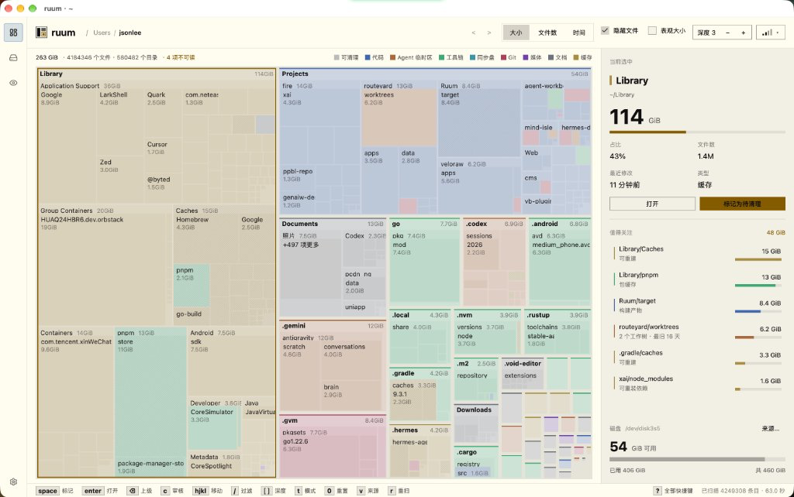

# ruum

[English](README.md) | [简体中文](README.zh.md) | [日本語](README.ja.md) | [한국어](README.ko.md)



Find what is filling a disk, mark what should go, and clean it up safely — with your volume's free space in view the whole time.

**ruum** is a cross-platform treemap disk analyzer and cleanup companion for **macOS**, **Linux**, and **Windows**. Built with [GPUI](https://gpui-kit.com/) and [gpui-omarchy](https://github.com/huacnlee/gpui-omarchy), it turns your drives and remote SSH servers into an interactive nested mosaic sized by real disk usage, pairs it with non-destructive mark-and-review workflows, and adds a low-overhead **Disk Space Watchdog**, **AI cleanup assistant**, and headless **`stdio` MCP server** (`ruum mcp`). The UI and CLI automatically localize into English, Simplified Chinese (`zh`), Japanese (`ja`), and Korean (`ko`).

## Why "Ruum"?

**Ruum** takes its name from the Old Norse sense of **spaciousness** and **open room** (*rúm*). A disk analyzer shouldn't just draw another dense tree of numbers — its purpose is to clear away accumulated build artifacts, forgotten caches, and stray clutter so your drives have open breathing room again.

---

## Table of Contents

1. [Installation & Initial Setup](#installation--initial-setup)
2. [Quick Start Tutorial (3 Steps to Free Up Space)](#quick-start-tutorial-3-steps-to-free-up-space)
3. [Remote Server Analysis over SSH](#remote-server-analysis-over-ssh)
4. [Disk Space Watchdog & AI Cleanup Assistant](#disk-space-watchdog--ai-cleanup-assistant)
5. [MCP Server Integration for AI Agents](#mcp-server-integration-for-ai-agents)
6. [CLI & Keyboard Shortcuts Reference](#cli--keyboard-shortcuts-reference)
7. [Safety Guards, Measurement Notes & Development](#safety-guards-measurement-notes--development)
8. [License](#license)

---

## Installation & Initial Setup

### Quick Install (One-Line Installer)

- **macOS & Linux** (installs the desktop app + `ruum` CLI, verified with SHA-256):
  ```sh
  curl -fsSL https://ruum-updates.jsonlee12138.com/install.sh | sh
  # Headless / server CLI only:
  curl -fsSL https://ruum-updates.jsonlee12138.com/install.sh | sh -s -- --cli-only
  ```
- **Windows (PowerShell)**:
  ```powershell
  irm https://ruum-updates.jsonlee12138.com/install.ps1 | iex
  ```

> **In-app & CLI updates:** Desktop installs check for signed updates automatically in the background (configurable in **Settings › Updates**, Stable or Beta channel; no silent downloads before clicking **Download & Update**). On headless servers, run `ruum update check` to verify releases and print the exact upgrade command.

### macOS

Install via Homebrew (macOS 11 or newer, Apple Silicon `aarch64-macos` & Intel `x86_64-macos`):

```sh
brew tap JsonLee12138/tap && brew install --cask ruum
```

Or download an installer from the [latest release](https://github.com/JsonLee12138/Ruum/releases/latest):

- **Disk image (`.dmg`):** open `ruum-*-aarch64-macos.dmg` (or `x86_64`) and drag `ruum.app` into `Applications`.
- **Installer package (`.pkg`):** run `ruum-*-aarch64-macos.pkg` to install `/Applications/ruum.app` and link `/usr/local/bin/ruum`.
- **Archive (`.zip`):** unzip `ruum-*-aarch64-macos.zip` and drag `ruum.app` into `Applications`.

**First-launch setup on macOS:**

1. **Clear Gatekeeper quarantine (for unsigned builds):** if macOS reports that the app cannot be verified or appears damaged, clear the browser quarantine attribute once:
   ```sh
   xattr -dr com.apple.quarantine /Applications/ruum.app
   ```
   *(Or open it once and choose **Open Anyway** in **System Settings › Privacy & Security**.)*
2. **Grant Full Disk Access:** to inspect protected locations (Mail, Messages, Safari, Trash, and other app containers), grant **ruum** **Full Disk Access** in **System Settings › Privacy & Security** — the side panel shows an **Open Privacy Settings** button whenever items are unreadable — then reopen the app. If you launch `ruum` from a terminal, your terminal app also needs Full Disk Access. macOS also prompts once for Desktop, Documents, and Downloads.

### Linux

Download a package from the [latest release](https://github.com/JsonLee12138/Ruum/releases/latest) (`x86_64` or `aarch64`):

- **Arch / Omarchy (AUR):**
  ```sh
  yay -S ruum-bin   # prebuilt release binary
  # or:
  yay -S ruum       # build from source
  ```
- **Debian / Ubuntu (`.deb`):** `sudo apt install ./ruum-*-x86_64-linux.deb`
- **Fedora / RHEL (`.rpm`):** `sudo dnf install ./ruum-*-x86_64-linux.rpm`
- **AppImage:** `chmod +x ruum-*-x86_64.AppImage && ./ruum-*-x86_64.AppImage`
- **Portable tarball:** unpack `ruum-*-x86_64-linux.tar.gz` and run `./install.sh` (or copy `ruum` onto your `PATH`).

**Hyprland floating window rule:** Hyprland tiles new windows by default; ruum works best in a roomy floating window (`class` is `ruum`):

```ini
windowrule = float, class:^(ruum)$
windowrule = size 1400 900, class:^(ruum)$
```

### Windows

On Windows 10 or 11 (`x86_64` or `aarch64`), download from the [latest release](https://github.com/JsonLee12138/Ruum/releases/latest):

- **Installer wizard (`-setup.exe`):** run `ruum-*-x86_64-windows-setup.exe` (supports silent install, Start Menu/Desktop shortcuts, and optional `PATH` registration).
- **MSI package (`.msi`):** install `ruum-*-x86_64-windows.msi` per-machine with Start Menu shortcut and optional `PATH` feature.
- **Portable archive (`.zip`):** unpack `ruum-*-x86_64-windows.zip` anywhere and run `ruum.exe`.

**NTFS fast scans on Windows:** when scanning a whole NTFS drive (such as `C:\`) without `--follow-links`, running as Administrator lets ruum read the NTFS Master File Table (MFT) directly — several times faster than directory traversal — and inspect protected folders like `System Volume Information`. The side panel offers **Restart as Administrator** whenever elevation can speed up or unlock unreadable items.

### Build from Source & Verify Downloads

Building requires **Rust 1.97 or newer** (pinned in `rust-toolchain.toml` via [rustup](https://rustup.rs)).

- **macOS & Linux** (Linux also requires a Wayland or X11 session with a Vulkan-capable GPU, plus the `musl` stdlib targets for embedded static SSH helpers):
  ```sh
  # Linux only (for embedded static SSH helpers, no C cross-compiler required):
  rustup target add x86_64-unknown-linux-musl aarch64-unknown-linux-musl

  git clone https://github.com/JsonLee12138/Ruum.git
  cd Ruum
  make install
  ```
  - On **Linux**, `make install` installs `~/.local/bin/ruum`, a desktop entry (adding an **Open with** handler for directories without changing your default file manager), and the `ruum.svg` icon. Use `sudo make install PREFIX=/usr/local` for system-wide installation, or `make uninstall` to remove everything it placed.
  - On **macOS**, `make install` builds and installs `~/Applications/ruum.app` and symlinks `~/.local/bin/ruum` (requires Xcode or Command Line Tools).
  - If an older binary earlier on `PATH` shadows `~/.local/bin/ruum`, add `export PATH="$HOME/.local/bin:$PATH"` to your shell configuration.
- **Windows** (MSVC toolchain / Visual Studio Build Tools with C++ workload):
  ```powershell
  git clone https://github.com/JsonLee12138/Ruum.git
  cd Ruum
  cargo build --release    # target\release\ruum.exe
  ```

**Verify release artifacts:** every release publishes `SHA256SUMS`, per-artifact `.sha256` files, and Sigstore build provenance attestations:

```sh
sha256sum -c SHA256SUMS --ignore-missing
gh attestation verify <downloaded-artifact> --repo JsonLee12138/Ruum
```

### Register the `ruum` CLI in `PATH`

If you installed the desktop app from a `.dmg`, `.zip`, or portable archive, register the `ruum` terminal command in one click:

1. Open **Settings** (`⌘,` on macOS, `Ctrl+,` on Linux & Windows, or click the gear icon in the Left Icon Rail).
2. Under **Command-Line Tool**, click **Install CLI Command** (also accessible from the macOS menu bar via **ruum › Install CLI Command…**).

This registers `/usr/local/bin/ruum` on macOS, `~/.local/bin/ruum` on Linux, or copies `ruum.exe` into `%LOCALAPPDATA%\Programs\ruum\bin` and updates your user `Path` on Windows — enabling `ruum`, `ruum ssh`, `ruum watchdog`, and `ruum mcp` from any shell or AI agent.

---

## Quick Start Tutorial (3 Steps to Free Up Space)

### Step 1: Choose a Source & Scan Root

1. **Launch ruum:** running `ruum` scans your home directory (`~`) immediately, largest entries first.
2. **Pick another folder, drive, or remote host:** press `v` (or click **Source…** in the right panel, click the **ruum** logo, or run `ruum --choose`) to open **Sources & Drives**:
   - Choose **This computer** (or enter an SSH target and click **Connect SSH**). Discovery lists mounts without probing network shares or scanning files.
   - Select a mounted volume and click **Scan selected root**, or type any absolute path and click **Scan directory**.
3. **Widen to the whole disk anytime:** press `g`, launch `ruum --disk`, or click an ancestor breadcrumb above your scan root (such as `/`). Widening is **memoized**: the subtree already scanned is reused so going from `~` to `/` only walks directories outside `~`.

### Step 2: Explore & Locate Space Hogs

Use the **Left Icon Rail** on the far left edge to switch between **Explore treemap**, **Sources & Drives**, **Watchdog**, and **Settings**.

In the **Explore** screen:

- **Read the treemap at a glance:**
  - **Tile area** shows proportional disk usage (or file count).
  - **Colors** classify what data is: **Code**, **Agent scratch**, **Toolchains**, **Synced**, **Git**, **Media**, **Documents**, and **Cache** (`Other` is neutral).
  - **Diagonal hatching** marks **Reclaimable** directories (caches, sync history, package stores, compiler/bundler build output, reinstallable dependencies, sandbox layers, snapshots, trash, temporary files).
- **Tune the view controls** in the top bar:
  - **Size / Files / Age** (`t`): switch between allocated bytes, file count, or last-write **Age** (**This week** through **Older**).
  - **Hidden files** (`i`): include or skip dotfiles and hidden folders (included by default because `~/.cache` often dominates home usage).
  - **Apparent size** (`d`): toggle between real allocated blocks (`st_blocks × 512`) and logical file lengths (`ls -l`).
  - **Depth 1–6** (`[` / `]`): draw fewer or more nested levels simultaneously (default `3`).
  - **Power Efficiency**: choose worker presets (`Miser`, `Balanced`, `Aggressive`, `Drain My Battery`) for future scans, or pass `--scan-threads` via CLI.
- **Navigate and filter quickly:**
  - **Scroll wheel** zooms smoothly toward the cursor and descends continuously into subdirectories; scroll out to climb back up.
  - Press `Enter` to open the selected directory at any depth, `Backspace` or `Esc` to step up, `Alt+←` / `Alt+→` (`⌘[` / `⌘]` on macOS, or mouse side buttons) to move through history, `← ↑ ↓ →` or `hjkl` to step between tiles, and `Tab` to cycle to the next largest sibling.
  - Press `/` to filter by name — only matching paths stay colored; press `Enter` to isolate matches or `Esc` to clear.
- **Inspect the right side panel:**
  - **Selection:** large size readout, **Of scan** percentage, **Files** count, **Last write** age, **Kind**, and hook-free **Git** status (uncommitted changes, stashes, unpushed commits), plus **Open** and **Mark for removal** buttons.
  - **Worth a look:** automatically surfaced top reclaimable folders, stale worktrees, and untouched experiment directories.
  - **Marked** & **Disk:** running list of marked items and a live **Disk** bar projecting how much free space you recover after cleanup.

### Step 3: Mark, Review & Clean Up Safely

Marking is **100% non-destructive** — nothing is touched on disk until you review and commit:

1. **Mark targets:** hover over any tile or select it with arrows and press `Space` or `x` (or `⌘`-click on macOS / `Ctrl`-click on Linux & Windows to mark without moving focus). Marking a directory automatically absorbs any marks inside it (**Goes with `<ancestor>`**), and space savings are never double-counted.
2. **Open Review:** press `c` or click **Review N marked · frees …** at the bottom of the side panel.
3. **Choose how to clean up (or hand off):**
   - **Move to trash** (`m`, default when available): moves items to the OS Trash / Recycle Bin / XDG Trash (`trash-put`, `gio trash`, or built-in XDG trash), so they remain recoverable until emptied.
   - **Delete permanently** (`p`): `rm -rf` semantics — always opens an explicit confirmation modal listing the items and bytes to be freed before anything is deleted.
   - **Export instead of deleting:** press `s` (**Save list…**) to export a plain path list, or `a` (**Copy as prompt**) to copy a carefully guarded prompt for a coding agent.
4. **Commit & verify:** press `Enter` (or click the action button). Once finished, **ruum** automatically rescans the root and opens **Done**, showing the actual **volume freed** measured before and after cleanup.

---

## Remote Server Analysis over SSH

Inspect servers without moving files or risking accidental remote deletions:

```sh
ruum ssh dev                 # connect and pick a remote mount or root
ruum ssh user@server /var    # scan a specific remote directory directly
ruum ssh dev --disk          # scan the volume holding the remote home directory
ruum ssh dev -a /srv         # measure apparent size on /srv
ruum ssh dev --check /var/log  # headless CLI summary without opening a GUI window
```

You can also connect from inside the app via **Sources & Drives › Connect SSH** by entering an SSH host alias or `user@host`.

### How Remote Scanner Deployment Works

- **Linux packaged builds (`make build` / `cargo xtask portable`):** bundle static `x86_64` and `aarch64` `musl` Linux scanners inside the executable. On connect, ruum checks the server's OS/CPU and uploads the matching helper to `~/.cache/ruum/ssh/<sha256>/` (checksum-verified, no `sudo`, no system package changes, no dependency on remote `glibc`). You can also extract a binary manually:
  ```sh
  ruum extract-scanner x86_64 ./ruum-scan
  ruum extract-scanner aarch64 ./ruum-scan-arm64
  ```
- **Development, macOS, or Windows desktop builds:** install the small headless helper (`ruum-scan`, no GUI dependencies) on the remote server's `PATH` or `~/.local/bin/ruum-scan`:
  ```sh
  # On the remote server inside a checkout:
  make install-scan
  # Or:
  cargo install --path crates/ruum-scan --locked
  ```
- **Authentication & connection safety:** ruum uses your normal SSH config, keys, and `ssh-agent`. Terminal launches can prompt for passwords/passphrases directly; GUI launches rely on key/agent auth or an SSH askpass helper. Connect once with `ssh dev` to trust the host key. One compressed SSH stream carries bounded records without storing the tree in remote memory, stops at nested mounts, and terminates cleanly on disconnect.

### Read-Only Remote Review & Safe Export Workflow

Remote GUI sessions are **strictly export-only** — trash/delete buttons, Git checks, and local reveal actions are disabled, and free space is sampled at scan time (press `r` to refresh):

1. Mark target paths on the treemap (`Space` / `x`), then press `c` to open **Review**.
2. Choose an export option:
   - **Copy as prompt** (`a`): includes SSH host, remote OS, scan root, marked paths, sizes, and mandatory safety instructions requiring hostname and machine ID verification before any deletion.
   - **Save list…** (`s`): saves remote paths locally, one path per line.
   - **Copy delete script** (`y`) / **Save delete script…** (`e`): produces a GNU/Linux shell script. Running the script with no flags **only previews** the targets; running `sh ruum-delete.sh --delete` connects to the SSH host, verifies that the remote server's actual kernel hostname and machine ID (`HostIdentity`) match the scanned machine (aborting on mismatch), and refuses system, root, home, mount-point, or symlink-redirected paths.

---

## Disk Space Watchdog & AI Cleanup Assistant

Let **ruum** watch your free space silently in the background (`O(1)` `statvfs` / disk-space check — zero background directory walks) and propose safe cleanup candidates when space runs low.

### 1. Configure Watchdog & Background Service

Open **Settings** (`⌘,` on macOS / `Ctrl+,` on Linux & Windows):

1. Toggle **Enable Watchdog Free-Space Monitoring**.
2. Toggle **Run as OS Background Service at Login (launchd / systemd / Windows)** to manage the native background daemon:
   - **macOS:** `launchd` user agent (`com.ruum.watchdog`)
   - **Linux:** `systemd --user` service (`ruum-watchdog.service`)
   - **Windows:** zero-UAC `HKCU\Software\Microsoft\Windows\CurrentVersion\Run` entry + hidden background process (`CREATE_NO_WINDOW`)
   *(You can also run the monitor manually from a terminal via `ruum watchdog` or a single check with `ruum watchdog --once`.)*
3. Adjust thresholds:
   - **Minimum Free Space Threshold (GB):** default `20` GB (min `1` GB).
   - **Check Interval (minutes):** default `5` minutes (min `30` seconds).
   - **Re-Alert Cooldown (min 5 minutes):** default `360` minutes / 6 hours (min `5` minutes).
4. Toggle **Automatically Run AI Analysis on Low Disk Space** if you want the configured AI CLI to prepare a cleanup proposal automatically when free space drops below your threshold.
5. Click **Save Settings**.

### 2. Configure an AI Assistant CLI

Still on the **Settings** page under **AI Assistant CLI**:

1. Choose a provider preset: **Agy**, **Pi**, **Codex**, or **Custom** (with **Custom Executable Command / Path** and **Custom Extra Arguments**).
2. Optionally set **Model Override (optional)**, click **Test CLI Connection** to verify the executable, or click **Fetch Models** and test latency per model (or benchmark all models) to pick the fastest model.
3. Click **Save Settings**.

### 3. Review & Confirm AI Cleanup Proposals

- Open the **Watchdog** page from the Left Icon Rail (or click the **System Tray / Menu Bar** icon) to inspect **Volume Status**, run **Check Disk Space Now**, trigger **Run AI Analysis Now**, or open **Review & Confirm…** (**Review Latest Proposal…** in the tray).
- **Nothing is ever deleted unattended.** Every AI proposal opens in the standalone **Confirm Cleanup** window (`ruum --confirm-cleanup ...`):
  - Inspect each candidate's read-only removal-mode badge (**Trash** / **Permanent**), path, byte size, reason, and local Git dirty/unpushed warning.
  - Use **Select All** / **Select None** or individual checkboxes to choose which paths to keep or clean.
  - Click **Confirm & Clean** (or **Cancel** to abort safely).
- *Tray residency note:* when the system tray / menu bar icon is active, closing the main window keeps ruum running quietly in the background; press `⌘Q` / `Ctrl+Q` (or `q` in Explore view), or choose **Quit Ruum** from the tray, to exit completely.

---

## MCP Server Integration for AI Agents

**ruum** includes a headless Model Context Protocol (`stdio` JSON-RPC 2.0) server with zero GUI startup and clean `stdout` framing (`ruum mcp`).

### Configure Your MCP Client

First ensure `ruum` is on `PATH` (via **Settings › Command-Line Tool › Install CLI Command**), then add `ruum` to your MCP client configuration:

```json
{
  "mcpServers": {
    "ruum": {
      "command": "ruum",
      "args": ["mcp"]
    }
  }
}
```

For strictly non-destructive analysis sessions, pass `--read-only`:

```json
{
  "mcpServers": {
    "ruum": {
      "command": "ruum",
      "args": ["mcp", "--read-only"]
    }
  }
}
```

### Exposed MCP Tools (8 Tools)

| Tool | Scope | Key Arguments | Safety Boundary |
| --- | --- | --- | --- |
| `list_volumes` | Local / SSH | `ssh_host?` | Read-only mount discovery; no file walk |
| `scan_directory` | Local / SSH | `path?`, `disk?`, `ssh_host?`, `apparent_size?`, `include_hidden?`, `max_entries?`, `rescan?` | Read-only scan; cached in session |
| `inspect_subtree` | Local / SSH | `root`, `subpath?`, `filter?`, `ssh_host?`, `max_entries?` | Read-only tree lookup & substring search |
| `find_reclaimable` | Local / SSH | `root`, `ssh_host?`, `limit?` | Read-only heuristic findings (caches, build dirs, worktrees) |
| `check_git_safety` | Local only | `paths` (array) | Hook-free read-only Git status; rejects `ssh_host` |
| `plan_removal` | Local / SSH | `root`, `targets` (array), `ssh_host?` | Dry-run validation against `removal` guards; never deletes |
| `trash_paths` | Local / SSH | `root`, `targets` (array), `ssh_host?` | Disabled in `--read-only`; **requires interactive GUI Confirm Cleanup checkbox approval** |
| `delete_permanently` | Local only | `root`, `targets` (array), `reason?` | Disabled in `--read-only`; forbidden over `ssh_host`; **requires GUI Confirm Cleanup checkbox approval + OS native auth (e.g. Touch ID)** |

If `CleanupConfirmAdapter` or OS native authentication fails, times out, or has no interactive desktop session, mutating tools fail closed and remove nothing.

---

## CLI & Keyboard Shortcuts Reference

### CLI Commands & Options

```sh
ruum [OPTIONS] [PATH]                  # scan PATH (defaults to ~)
ruum ssh HOST [OPTIONS] [PATH]         # inspect a remote host over SSH (read-only)
ruum mcp [--read-only]                 # run stdio MCP server
ruum watchdog [--once]                 # run disk watchdog daemon (or single check)
ruum update [check] [--channel stable|beta] [--json]
                                       # check signed releases & print upgrade command
ruum config update get|set [...]       # inspect or configure update preferences
ruum extract-scanner ARCH OUTPUT       # extract embedded Linux helper (x86_64 | aarch64)
```

| Flag | Description |
| --- | --- |
| `--choose` | Open **Sources & Drives** before scanning |
| `-a`, `--apparent-size` | Measure apparent file length instead of allocated blocks |
| `-l`, `--follow-links` | Follow symlinks (local scans only) |
| `-H`, `--no-hidden` | Skip dotfiles and dot-directories |
| `-D`, `--disk` | Scan the whole disk containing your home directory |
| `-X`, `--cross-filesystems` | Include other mounted disks, network shares, and pseudo-filesystems below `PATH` (local only; off by default) |
| `-d`, `--depth N` | Initial treemap levels drawn at once (`1`–`6`, default `3`) |
| `--power-efficiency PRESET` | Worker preset: `miser`, `balanced` (default), `aggressive`, `drain-my-battery` |
| `--scan-threads N` | Fixed scan workers (capped by available CPU count) |
| `--adaptive-threads` | Opt into experimental adaptive thread admission |
| `--fixed-threads` | Disable adaptive admission and CPU governor |
| `--thread-throughput-percent N` | Retain this percent of sampled initial throughput (default `80`) |
| `--thread-system-cpu-percent N` | Best-effort host CPU budget percent; `0` disables (default `80`) |
| `--metric files\|bytes` | Rank tiles by file count (`files`) or bytes (`bytes`) |
| `--open-screen SCREEN` | Start directly on `explore`, `sources`, `watchdog`, or `settings` |
| `--check` | With `ssh`: deploy helper and print scan summary without opening a window |
| `-h`, `--help` | Show localized CLI usage help |

### Keyboard & Mouse Shortcuts — Explore View

| Key / Input | Action |
| --- | --- |
| `Space` / `x` | Mark or unmark the pointed/selected tile |
| `Ctrl`-click (`⌘`-click on macOS) | Mark or unmark without moving the selection |
| `Enter` | Open the selected directory at any depth |
| `Backspace` (`⌫`) / `Esc` / `u` | Go up one directory (when no filter/scan/selection overrides `Esc`) |
| `Alt+←` / `Alt+→` (`⌘[` / `⌘]` on macOS, mouse side buttons) | Navigate back and forward through visited directories |
| `←` `↑` `↓` `→` / `h` `j` `k` `l` | Move between tiles at the current level |
| `Tab` / `Shift+Tab` | Next / previous largest sibling |
| Scroll wheel | Zoom toward a directory and enter it continuously |
| `Shift`-scroll | Pan the magnified treemap view |
| `[` / `]` | Draw fewer or more treemap depth levels (`1`–`6`) |
| `-` / `=` (`+`) / `0` | Shrink, magnify, or reset the view transform |
| `Ctrl` (`⌘` on macOS) + `=` / `-` / `0` | Interface zoom |
| `/` (or `s`) | Filter by name (`Enter` shows only matches; `Esc` clears) |
| `c` | Open **Review** for marked items |
| `t` | Cycle **Size**, **Files**, and **Age** modes |
| `d` | Toggle **Disk usage** vs **Apparent size** |
| `i` | Toggle **Hidden files** |
| `r` / `Ctrl+R` (`⌘R` on macOS) / `F5` | Scan again from the same root |
| `Esc` (while scanning) | Cancel the scan in progress |
| `v` | Open **Sources & Drives** |
| `Ctrl+O` (`⌘O` on macOS) | Choose another local directory to scan |
| `g` | Scan the whole disk (or click an ancestor breadcrumb above root) |
| `p` | Show or hide the selection details panel |
| `o` / `Ctrl+Shift+R` (`⌘⇧R`) / Right-click | Reveal in Finder, File Explorer, or the file manager |
| `Ctrl+,` (`⌘,` on macOS) | Open **Settings** |
| `?` | Toggle full keyboard & mouse help overlay |
| `q` / `Ctrl+Q` (`⌘Q` on macOS) | Quit ruum (`Ctrl+W` / `⌘W` closes the focused window) |

### Keyboard Shortcuts — Review View

| Key | Action |
| --- | --- |
| `m` | Select **Move to trash** (local only) |
| `p` | Select **Delete permanently** (local only) |
| `!` | Unmark all items |
| `s` | **Save list…** (one path per line) |
| `a` | **Copy as prompt** for a coding agent |
| `y` / `e` | **Copy delete script** / **Save delete script…** (exports a preview-first GNU/Linux shell script for shell or remote SSH review) |
| `Enter` | Commit the chosen removal mode (local only; permanent always confirms) |
| `Esc` | Go back to **Explore** |

---

## Safety Guards, Measurement Notes & Development

### Built-In Removal & Git Safety Guards

All deletion rules are enforced in `crates/ruum-core/src/removal.rs` and backed by tests against real directory trees:

- Only paths strictly inside the scanned root can be removed.
- The filesystem root, the scanned root, your home directory, and any directory holding your home directory or a system tree are always refused.
- Mount points and directories containing mount points are refused; permanent deletion stops at mount boundaries rather than crossing filesystems.
- Protected OS and package-manager trees (`/usr`, `/etc`, `/boot`, `/var/lib`, `/nix/store`, `/gnu/store`, Homebrew prefixes, etc.) are refused even when writable.
- On Windows, `Windows`, `Program Files`, `ProgramData`, `System Volume Information`, `Recovery`, `Boot`, page/hibernation files, and top-level user profile folders (`FOLDERID_UserProfiles`, e.g. `C:\Users\*`) are refused, while subdirectories inside profiles remain cleanable.
- Symlinks are unlinked rather than followed; paths are never interpolated into a shell (a file named `-rf` is treated safely as a filename).
- Git inspection runs read-only with fsmonitor, hooks, and pager disabled, and refuses to evaluate repositories with custom filter drivers.

### Disk Accounting & Platform Differences

- **Allocated blocks vs. apparent size:** default sizes come from `st_blocks × 512` (Unix) and NTFS cluster allocation (Windows), matching what is actually reclaimed on delete.
- **Hardlinks counted once:** multiple hardlinks to the same inode are deduplicated during bottom-up tree aggregation.
- **One volume per projection:** nested mount points (including Linux bind mounts and same-device `btrfs` subvolumes) are skipped by default; when `-X` is used locally, marks on other volumes are excluded from the live free-space projection meter.
- **macOS specifics:** free space matches `df` (excluding Finder's purgeable space); APFS file clones share blocks so deleting one copy may free less than shown; Time Machine local snapshots are excluded from walks; cloud-evicted folders (iCloud Drive, Dropbox) are never opened or downloaded.

### Development

```sh
make run       # release build, opening Sources & Drives
make lint      # rustfmt --check + clippy --all-targets -D warnings
make test      # core unit/filesystem tests + GPUI window-harness tests
make test-ssh  # real localhost SSH tests (Linux; requires bun + openssh)
make ci        # lint, then test
```

On Windows, run `cargo xtask lint`, `cargo xtask test`, and `cargo build --release` directly.

| Path | Responsibility |
| --- | --- |
| `crates/ruum-core` | Scanning, tree aggregation, squarified layout, space accounting, removal guards, Watchdog, AI CLI, SSH & MCP |
| `crates/ruum-scan` | Lightweight headless remote SSH scanner binary (no GUI dependencies) |
| `crates/ruum-app` | GPUI desktop interface, state/keybindings, localization (`en`/`zh`/`ja`/`ko`), tray & window-harness tests |
| `xtask/`, `packaging/`, `assets/` | Release bundling, cross-platform installers, icons, and desktop entry templates |

---

## License

`GPL-3.0-only` — see [LICENSE](LICENSE). Portions derived from upstream `disktree` / `ruum` are attributed under the MIT License in [THIRD_PARTY_NOTICES.md](THIRD_PARTY_NOTICES.md).
