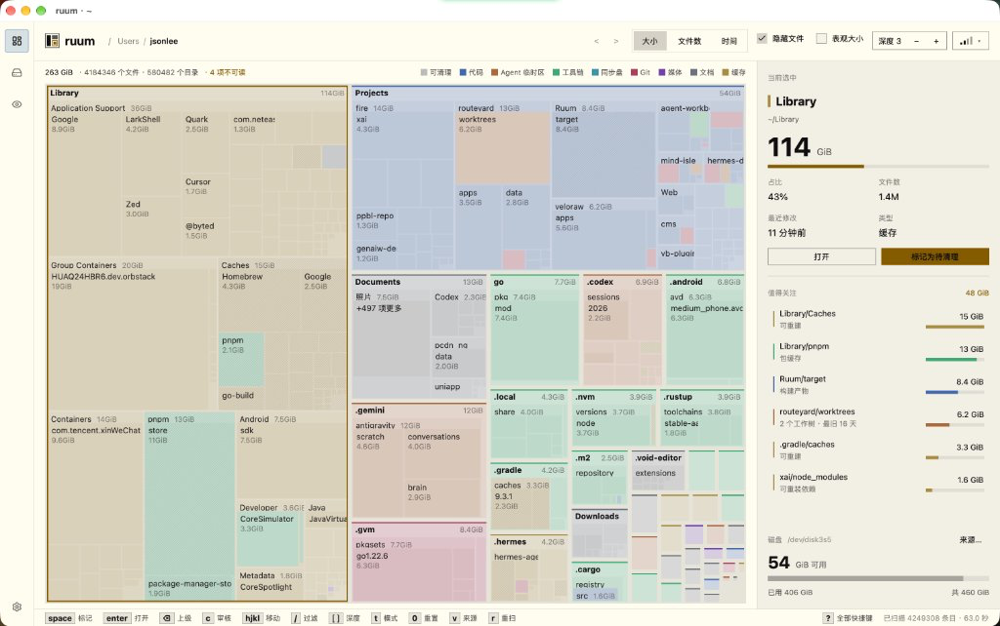

# ruum

[English](README.md) | [简体中文](README.zh.md) | [日本語](README.ja.md) | [한국어](README.ko.md)



快速定位磁盘空间占用大户，标记待清理项并安全释放空间——同时在屏幕上实时掌握当前卷的可用容量变化。

**ruum** 是一款支持 **macOS**、**Linux** 与 **Windows** 的交互式磁盘空间树状图分析与安全清理工具。基于 [GPUI](https://gpui-kit.com/) 与 [gpui-omarchy](https://github.com/huacnlee/gpui-omarchy) 构建，它将本地驱动器与远程 SSH 服务器绘制为按真实磁盘占用比例缩放的嵌套树状图，提供“先标记、再审核、后清理”的非破坏性工作流，并内置低开销的**磁盘空间守护（Watchdog）**、**AI 清理助手**以及面向 AI Agent 的 `stdio` **MCP 服务器**（`ruum mcp`）。界面与 CLI 会根据系统语言自动切换英文、简体中文（`zh`）、日语（`ja`）和韩语（`ko`）。

## 为什么叫 "Ruum"？

**Ruum** 源自古诺尔斯语中表示**开阔空间 / 宽敞余地**（*rúm*）的词义。磁盘分析工具不应只是冷冰冰的目录数字列表，它的使命是帮您扫除陈旧构建产物、冗余缓存与意外堆积，让每一块硬盘重新拥有通透、宽敞的呼吸空间。

---

## 目录

1. [安装与初始配置](#安装与初始配置)
2. [快速上手教程（三步释放磁盘空间）](#快速上手教程三步释放磁盘空间)
3. [通过 SSH 分析远程服务器](#通过-ssh-分析远程服务器)
4. [磁盘空间守护与 AI 清理助手](#磁盘空间守护与-ai-清理助手)
5. [接入 MCP 服务器（供 AI Agent 调用）](#接入-mcp-服务器供-ai-agent-调用)
6. [CLI 命令与快捷键速查](#cli-命令与快捷键速查)
7. [安全防护、统计说明与开发指南](#安全防护统计说明与开发指南)
8. [开源协议](#开源协议)

---

## 安装与初始配置

### 一键快速安装

- **macOS 与 Linux**（自动安装桌面端与 `ruum` CLI 并执行 SHA-256 校验）：
  ```sh
  curl -fsSL https://ruum-updates.jsonlee12138.com/install.sh | sh
  # 仅安装无头 / 服务器端 CLI：
  curl -fsSL https://ruum-updates.jsonlee12138.com/install.sh | sh -s -- --cli-only
  ```
- **Windows（PowerShell）**：
  ```powershell
  irm https://ruum-updates.jsonlee12138.com/install.ps1 | iex
  ```

> **应用内更新与 CLI 检测：** 桌面端会在后台自动检查新版本（可在 **设置 › 更新** 中切换 **稳定版（Stable）** / **测试版（Beta）** 通道或关闭自动检查；点击 **下载并更新** 前绝不会下载安装包）。**设置 › 更新** 中的 **发送匿名使用统计** 开关可随时关闭（也可执行 `ruum config update set --send-client-id false`），全程零 IP 地址、零用户路径记录。无头服务器可运行 `ruum update check` 检查新版本说明并获取精确升级命令。Linux AppImage 同时支持内置应用内更新（Stable / Beta）以及配套 `.AppImage.zsync` 文件供 `AppImageUpdate` / `Gear Lever` 增量更新（固定追踪稳定版 `latest`）。

### macOS

通过 Homebrew 安装（支持 Apple Silicon `aarch64-macos` 与 Intel `x86_64-macos`，需 macOS 11 及以上）：

```sh
brew tap JsonLee12138/tap && brew install --cask ruum
```

或从 [最新 Release 页面](https://github.com/JsonLee12138/Ruum/releases/latest) 下载安装包：

- **磁盘镜像（`.dmg`）：** 打开 `ruum-*-aarch64-macos.dmg`（或 `x86_64`），将 `ruum.app` 拖入 `Applications`（应用程序）。
- **安装包（`.pkg`）：** 运行 `ruum-*-aarch64-macos.pkg`，将安装 `/Applications/ruum.app` 并自动链接 `/usr/local/bin/ruum`。
- **压缩包（`.zip`）：** 解压 `ruum-*-aarch64-macos.zip` 后将 `ruum.app` 拖入 `Applications`。

**macOS 首次启动配置：**

1. **解除 Gatekeeper 隔离属性（未签名版本）：** 若系统提示“已损坏，无法打开”或“无法验证开发者”，可执行一次以下命令清除隔离标记：
   ```sh
   xattr -dr com.apple.quarantine /Applications/ruum.app
   ```
   *（或者尝试打开一次后，前往 **系统设置 › 隐私与安全性** 点击 **仍要打开**。）*
2. **授予“完全磁盘访问权限”：** 如需扫描邮件、信息、Safari、废纸篓及其他应用容器等受保护目录，请在 **系统设置 › 隐私与安全性** 中为 **ruum** 开启**完全磁盘访问权限**——当扫描遇到受限目录时，右侧面板也会出现 **打开隐私设置** 按钮——授权后重启应用即可。若从终端启动 `ruum`，则需要为该终端应用授予权限。首次访问桌面、文稿与下载目录时，macOS 也会分别弹窗询问一次。

### Linux

从 [最新 Release 页面](https://github.com/JsonLee12138/Ruum/releases/latest) 下载对应架构（`x86_64` 或 `aarch64`）的安装包：

- **Arch / Omarchy（AUR）：**
  ```sh
  yay -S ruum-bin   # 安装预编译二进制包
  # 或：
  yay -S ruum       # 从源码编译安装
  ```
- **Debian / Ubuntu（`.deb`）：** `sudo apt install ./ruum-*-x86_64-linux.deb`
- **Fedora / RHEL（`.rpm`）：** `sudo dnf install ./ruum-*-x86_64-linux.rpm`
- **AppImage：** `chmod +x ruum-*-x86_64.AppImage && ./ruum-*-x86_64.AppImage`（支持应用内自动更新，并附带 `.AppImage.zsync` 供 `AppImageUpdate` / `Gear Lever` 追踪稳定版 `latest` 增量更新）。
- **便携压缩包（`.tar.gz`）：** 解压 `ruum-*-x86_64-linux.tar.gz` 后运行 `./install.sh`（或直接将 `ruum` 放到 `PATH` 中）。

**Hyprland 浮动窗口规则：** Hyprland 默认平铺新窗口，建议为 `ruum`（窗口类名为 `ruum`）配置宽松的浮动规则：

```ini
windowrule = float, class:^(ruum)$
windowrule = size 1400 900, class:^(ruum)$
```

### Windows

支持 Windows 10 / 11（`x86_64` 与 `aarch64`），从 [最新 Release 页面](https://github.com/JsonLee12138/Ruum/releases/latest) 下载：

- **安装向导（`-setup.exe`）：** 运行 `ruum-*-x86_64-windows-setup.exe`（支持静默安装、创建开始菜单/桌面快捷方式及可选写入 `PATH`）。
- **MSI 安装包（`.msi`）：** 运行 `ruum-*-x86_64-windows.msi` 执行系统级安装。
- **绿色便携包（`.zip`）：** 解压 `ruum-*-x86_64-windows.zip` 到任意目录并运行 `ruum.exe`。

**Windows 管理员极速整盘扫描：** 当在未启用 `--follow-links` 的情况下扫描整块 NTFS 磁盘（例如 `C:\`）时，以管理员身份运行会直接从 NTFS 主文件表（MFT）高速读取目录结构（比常规遍历快数倍），并可读取 `System Volume Information` 等受限路径。普通权限启动时，右侧面板会在合适时机显示 **以管理员身份重启** 按钮。

### 从源码编译与下载校验

源码编译需要 **Rust 1.97 或更高版本**（仓库根目录的 `rust-toolchain.toml` 已锁定版本，通过 [rustup](https://rustup.rs) 会自动拉取）。

- **macOS 与 Linux**（Linux 需在支持 Vulkan GPU 的 Wayland 或 X11 会话下运行；macOS 与 Linux 均通过安装以下两个 `musl` 标准库目标，在 `make install` / `make bundle` 时自动内嵌静态 Linux SSH 扫描器，无需外部 C 交叉编译器）：
  ```sh
  # macOS 与 Linux 通用（用于内嵌静态 Linux SSH 扫描器，无需外部 C 交叉编译器）：
  rustup target add x86_64-unknown-linux-musl aarch64-unknown-linux-musl

  git clone https://github.com/JsonLee12138/Ruum.git
  cd Ruum
  make install
  ```
  - **Linux：** `make install` 会构建并安装内嵌静态扫描器的 `~/.local/bin/ruum`、`~/.local/bin/ruum-gui`、桌面入口文件（为目录添加**打开方式**入口，不会篡改默认文件管理器）以及 `ruum.svg` 图标；系统级安装可使用 `sudo make install PREFIX=/usr/local`，卸载运行 `make uninstall`。
  - **macOS：** `make install` 会构建并安装 `~/Applications/ruum.app`（已安装 `musl` 目标时会自动内嵌 `Contents/Resources/ruum-scan-linux.pack`），同时软链至 `~/.local/bin/ruum`（需要 Xcode 或 Command Line Tools）。若在 macOS 上跳过 `musl` 目标，`make install` 会提示警告但正常完成，远程 SSH 将自动降级复用远端缓存或服务端安装的 `ruum-scan`。
  - 若 `PATH` 中有其他旧版本覆盖了 `~/.local/bin/ruum`，请将 `export PATH="$HOME/.local/bin:$PATH"` 写入您的 Shell 配置文件。
- **Windows**（需 MSVC 工具链 / Visual Studio Build Tools C++ 工作负载）：
  ```powershell
  git clone https://github.com/JsonLee12138/Ruum.git
  cd Ruum
  cargo build --release    # 生成 target\release\ruum.exe
  ```

**校验下载产物：** 每个 Release 均附带 `SHA256SUMS`、单文件 `.sha256` 校验文件及 Sigstore 构建溯源证明：

```sh
sha256sum -c SHA256SUMS --ignore-missing
gh attestation verify <已下载的文件> --repo JsonLee12138/Ruum
```

### 将 `ruum` CLI 注册到 `PATH`

如果您通过 `.dmg`、`.zip` 或便携压缩包安装桌面版，可在应用内一键注册终端命令：

1. 打开 **设置**（macOS 按 `⌘,`，Linux / Windows 按 `Ctrl+,`，或点击左侧图标导航栏底部的齿轮图标）。
2. 在 **命令行工具** 区域点击 **安装 CLI 命令**（macOS 也可通过顶部菜单栏 **ruum › 安装命令行工具…** 触发）。

执行后：macOS 会链接至 `/usr/local/bin/ruum`，Linux 会链接至 `~/.local/bin/ruum`，Windows 会将 `ruum.exe`（连同同级 `ruum-gui.exe`）复制到 `%LOCALAPPDATA%\Programs\ruum\bin` 并写入用户环境变量 `Path`，随后即可在任意终端或 AI Agent 中调用 `ruum`、`ruum ssh`、`ruum watchdog` 与 `ruum mcp`。后续 Windows 端通过应用内更新升级时，也会自动保持 `%LOCALAPPDATA%\Programs\ruum\bin` 中的 `ruum.exe`、`ruum-gui.exe` 与 `ruum-scan-linux.pack` 同步。

---

## 快速上手教程（三步释放磁盘空间）

### 第一步：选择来源与扫描根目录

1. **直接启动：** 无参数运行 `ruum` 时默认直接扫描用户主目录（`~`），大目录优先呈现。
2. **切换挂载卷、目录或远程主机：** 按 `v`（或点击右侧面板的 **来源…**、点击左上角 **ruum** 徽标，或命令行启动 `ruum --choose`）打开 **来源与驱动器** 页面：
   - 选择 **本机**，或输入主机名后点击 **连接 SSH**。来源发现仅读取挂载点列表，不会主动扫描文件或触发网络挂载探测。
   - 选中一个已挂载卷点击 **扫描所选根目录**，或输入绝对路径点击 **扫描目录**。
3. **随时扩展为整盘扫描：** 按 `g`、命令行运行 `ruum --disk`，或直接点击顶部面包屑中扫描根目录上方的父级路径（如 `/`）。向上扩展扫描具备**结果复用（记忆化）**：已经扫描过的子树会被直接复用，从 `~` 扩展到 `/` 只需补充扫描 `~` 之外的目录。

### 第二步：浏览树状图并定位空间大户

通过窗口最左侧的**图标导航栏**，可在 **浏览树状图**、**来源与驱动器**、**空间守护** 和 **设置** 四个页面间随时切换。

在 **浏览树状图** 页面中：

- **读懂树状图区块：**
  - **面积**代表磁盘实际占用（或文件数量）。
  - **颜色**区分数据类别：**代码**、**Agent 临时区**、**工具链**、**同步盘**、**Git**、**媒体**、**文档** 与 **缓存**（未识别项为中性的 **其他**）。
  - **斜线纹理**标识 **可清理** 目录（包括缓存、同步历史版本、包管理器仓库、构建产物、可重装依赖、沙盒镜像层、快照、废纸篓与临时文件）。在扫描尚未完成前，主区域会先展示有界的实时顶层概览，扫完后无缝切换为完整可交互树状图。
- **使用顶部视图控件：**
  - **大小 / 文件数 / 时间**（`t`）：在字节占用、文件数量和最近写入**时间**（从**本周**到**更早**渐变着色）之间切换。
  - **隐藏文件**（`i`）：包含或跳过以点开头的隐藏文件与目录（默认包含，因为 `~/.cache` 往往是主目录占用大户）。
  - **表观大小**（`d`）：在实际占用块大小（`st_blocks × 512`）与文件表观长度（`ls -l`）间切换。
  - **深度 1–6**（`[` / `]`）：调节一次绘制的嵌套层级数（默认 `3`）。
  - **电源效率**：选择后续扫描的线程预设——**节能**（`miser`）、**均衡**（`balanced`）、**性能**（`aggressive`）、**全速狂飙**（`drain-my-battery`），或通过 CLI 参数 `--scan-threads` 自定义工作线程数。
- **高效导航与名称过滤：**
  - **鼠标滚轮**向指针所在目录平滑放大并连续进入子目录；反向滚动即可退回上级。
  - 按 `Enter` 进入任意深度的选中目录，按 `Backspace`（`⌫`）或 `Esc` 返回上一级；使用 `Alt+←` / `Alt+→`（macOS 也支持 `⌘[` / `⌘]`，以及鼠标侧键）在浏览历史间前进后退；使用方向键或 `hjkl` 移动选中，按 `Tab` 跳至下一个较大的同级项目。
  - 按 `/` 打开名称过滤：仅匹配项保留高亮色彩；按 `Enter` 仅显示匹配项，按 `Esc` 清除过滤。
- **善用右侧详情面板：**
  - **当前选中：** 显示大号空间数值、**占比**、**文件数**、**最近修改**、**类型** 以及无钩子只读 **Git** 状态（未提交更改、贮藏、未推送提交），并提供 **打开** 与 **标记为待清理** 按钮。
  - **值得关注：** 自动汇总体积最大的可重建缓存、构建产物、长期未动的工作树与实验目录。
  - **已标记** 与 **磁盘：** 实时汇总待清理列表，并在底部 **磁盘** 计量条上推演清理后的剩余可用空间。

### 第三步：标记、审核并安全执行清理

标记操作**完全非破坏性**——在您进入审核并最终确认前，磁盘上的任何文件都不会被修改：

1. **标记待清理目标：** 将指针指向任意区块或用方向键选中后，按 `Space` 或 `x` 标记/取消标记（macOS 按住 `⌘`-单击、Linux/Windows 按住 `Ctrl`-单击可直接标记而不移动当前焦点）。标记父目录会自动吸收其内部已有标记（显示 **随 `<父目录>` 一同清理**），节省空间绝不重复计算。
2. **进入审核页面：** 按 `c` 或点击右侧面板底部的 **审核 N 项标记 · 释放 …** 打开 **审核清理** 页面。
3. **选择清理方式或导出清单：**
   - **移至废纸篓**（`m`，当系统支持废纸篓时为默认项）：移入系统废纸篓 / 回收站 / XDG 废纸篓（依次适配 `trash-put`、`gio trash` 与内置 XDG Trash），清空前均可恢复。
   - **永久删除**（`p`）：等同 `rm -rf`，无法恢复。执行前**始终会弹出确认窗口**，明确列出待删目标与释放空间。
   - **暂不删除、先导出：** 按 `s`（**保存列表…**）保存为每行一个路径的文本文件，或按 `a`（**复制为提示词**）复制附带检查注意事项的编码 Agent 提示词。
4. **确认执行与自动重扫：** 按 `Enter`（或点击底部的执行按钮）开始清理。完成后 **ruum** 会自动重新扫描当前根目录，并在 **完成** 界面展示清理前后实测的**卷实际释放**空间。

---

## 通过 SSH 分析远程服务器

无需把文件下载到本地，也不用担心误删远程服务文件：

```sh
ruum ssh dev                   # 连接并选择远程挂载点或目录
ruum ssh user@server /var      # 直接扫描指定远程路径
ruum ssh dev --disk            # 扫描远程主目录所在的整块磁盘
ruum ssh dev -a /srv           # 对 /srv 统计表观大小
ruum ssh dev --check /var/log  # 无窗口模式：部署辅助扫描器并输出扫描摘要
```

您也可以直接在图形界面的 **来源与驱动器 › 连接 SSH** 中输入 SSH 别名或 `user@host` 完成连接。

### 远程扫描器部署机制

- **官方发布版本（macOS、Windows 与 Linux）及带 `musl` 目标的源码构建：** 均内置静态编译的 `x86_64` 与 `aarch64` `musl` Linux 扫描器（Linux 直接附加在主二进制末尾；macOS 与 Windows 打包在随附资源 `ruum-scan-linux.pack` 中）。连接 SSH 时会自动检测服务器操作系统与 CPU 架构，并在缓存缺失或损坏时通过 SSH 自动上传并校验匹配二进制至远程 `~/.cache/ruum/ssh/<sha256>/ruum-scan`（原子替换，无需 `sudo`、不改系统包、不依赖远程 `glibc` 版本）。也可手动提取扫描器：
  ```sh
  ruum extract-scanner x86_64 ./ruum-scan
  ruum extract-scanner aarch64 ./ruum-scan-arm64
  ```
- **开发构建或未带 `musl` 目标的本地源码构建：** 连接远程主机时会自动检测远端 `PATH` 或 `~/.local/bin/ruum-scan`，若缺失则自动复用远端已有的 `~/.cache/ruum/ssh/*/ruum-scan` 缓存；若目标服务器上尚未安装过任何扫描器，可先安装轻量无 GUI 依赖的 **ruum-scan** 辅助程序：
  ```sh
  # 在远程服务器的代码目录中执行：
  make install-scan
  # 或者：
  cargo install --path crates/ruum-scan --locked
  ```
- **认证与连接安全：** 完整沿用您本机的 SSH 配置、密钥与 `ssh-agent`。从终端启动时可在终端输入密码/口令；从图形启动器打开时依赖密钥/Agent 或 SSH askpass 程序。建议首次连接先执行一次 `ssh dev` 以确认主机指纹。整个扫描过程通过单条压缩 SSH 通道流式传回记录，远程辅助进程不在内存中保留目录树、自动跳过嵌套挂载点，并在断开连接时立即退出。

### 远程只读审核与安全脚本导出流程

远程会话在界面中为**严格只读（仅导出）**——删除/废纸篓按钮、Git 检测和本地文件管理器定位均已禁用，可用空间显示为扫描时的快照（按 `r` 刷新）：

1. 在树状图上用 `Space` / `x` 标记需要清理的远程目录，按 `c` 进入 **审核清理**。
2. 选择所需的导出方式：
   - **复制为提示词**（`a`）：包含 SSH 主机、远程操作系统、扫描根目录、所选路径、体积与防误删校验要求（执行前必须核验实际主机名与机器 ID）。
   - **保存列表…**（`s`）：将选中的远程路径按行保存为本地文本文件。
   - **复制删除脚本**（`y`） / **保存删除脚本…**（`e`）：生成“预览优先”的 GNU/Linux Shell 脚本。直接无参数运行该脚本**仅做预览**；确认无误后执行 `sh ruum-delete.sh --delete`，脚本会连接对应 SSH 主机并先核验目标服务器的内核主机名（`hostname`）与机器 ID（`HostIdentity`）是否与扫描时一致（不匹配或缺失立即中止），同时严格拒绝系统目录、扫描根目录、主目录及祖先、挂载点与符号链接重定向路径。

---

## 磁盘空间守护与 AI 清理助手

让 **ruum** 在后台以近乎零开销的方式守护磁盘空间（轮询仅调用 $O(1)$ 的系统容量查询，绝不静默全盘扫目录），在可用空间不足时主动发送通知并生成 AI 清理建议。

### 1. 配置空间守护与系统后台服务

打开 **设置** 页面（macOS 按 `⌘,`，Linux / Windows 按 `Ctrl+,`）：

1. 勾选 **启用空间守护可用空间监控**。
2. 勾选 **登录时作为系统后台服务运行 (launchd / systemd / Windows)**，即可注册对应系统的原生后台服务：
   - **macOS：** `launchd` 用户代理（`com.ruum.watchdog`）
   - **Linux：** `systemd --user` 用户服务（`ruum-watchdog.service`）
   - **Windows：** 零 UAC 弹窗的 `HKCU\Software\Microsoft\Windows\CurrentVersion\Run` 登录自启 + 隐藏后台守护进程（`CREATE_NO_WINDOW`）
   *（也可随时在终端运行 `ruum watchdog` 启动轮询循环，或运行 `ruum watchdog --once` 执行单次检测。）*
3. 按需设定监控参数：
   - **最低可用空间阈值 (GB)：** 默认 `20` GB（最低 `1` GB）。
   - **检测间隔（分钟）：** 默认 `5` 分钟（底层最低 `30` 秒）。
   - **重复提示冷却时间（最低 5 分钟）：** 默认 `360` 分钟 / 6 小时（最低 `5` 分钟）。
4. 勾选 **磁盘空间不足时自动运行 AI 分析**，空间跌破阈值时自动调用配置好的 AI CLI 扫描可回收项并形成提案。
5. 点击 **保存设置**。

### 2. 配置 AI 助手 CLI

在同一 **设置** 页面的 **AI 助手 CLI** 区域：

1. 选择预设助手：**Agy**、**Pi**、**Codex** 或 **自定义**（可指定 **自定义可执行命令 / 路径** 与 **自定义附加参数**）。
2. 可选填写 **指定模型（可选）**，点击 **测试 CLI 连接** 校验可执行路径，或点击 **获取模型列表** 并直接为每个模型或全部模型测速，挑选响应最快的模型。
3. 点击 **保存设置**。

### 3. 查看状态、触发分析与人工确认清理

- 点击左侧图标导航栏的 **空间守护**（或点击系统托盘 / 菜单栏图标），可查看当前 **卷状态**、点击 **立即检查磁盘空间** 或 **立即运行 AI 分析**，并在生成建议后点击 **查看并确认…**（托盘菜单中为 **查看最新建议…**）。
- **绝不未经确认自动删除任何文件。** 所有 AI 清理建议都会在独立的 **ruum · 确认清理** 窗口（`ruum --confirm-cleanup ...`）中呈现：
  - 逐条核对候选项的只读清理模式标记（**废纸篓** / **永久删除**）、路径、占用大小、清理理由与本地 Git 风险提示（未提交改动或未推送提交）。
  - 使用 **全选** / **全不选** 或单独勾选/取消勾选复选框，决定保留或清理哪些目录。
  - 点击 **确认清理** 后方可执行；点击 **取消** 或关闭窗口则完全中止。
- *托盘驻留提示：* 当系统托盘 / 菜单栏图标启用时，关闭主窗口会让 **ruum** 保持在后台托盘驻留以便随时响应守护与快速唤醒；如需完全退出，请按 `⌘Q` / `Ctrl+Q`（或在探索视图按 `q`），或在托盘菜单中点击 **退出 Ruum**。

---

## 接入 MCP 服务器（供 AI Agent 调用）

**ruum** 提供纯无头运行的 `stdio` JSON-RPC 2.0 MCP 服务器（`ruum mcp`），不初始化任何图形窗口，保证 `stdout` 零污染。

### 配置 MCP 客户端

先确保已通过 **设置 › 命令行工具 › 安装 CLI 命令** 将 `ruum` 注册到 `PATH`，然后在您的 MCP 客户端配置中加入：

```json
{
  "mcpServers": {
    "ruum": {
      "command": "ruum",
      "args": ["mcp"]
    }
  }
}
```

若希望仅开放只读探测与方案规划能力，请附加 `--read-only` 参数：

```json
{
  "mcpServers": {
    "ruum": {
      "command": "ruum",
      "args": ["mcp", "--read-only"]
    }
  }
}
```

### 提供的 8 个 MCP 工具

| 工具名称 | 适用范围 | 主要参数 | 安全边界 |
| --- | --- | --- | --- |
| `list_volumes` | 本地 / SSH | `ssh_host?` | 只读挂载点发现；不遍历文件 |
| `scan_directory` | 本地 / SSH | `path?`, `disk?`, `ssh_host?`, `apparent_size?`, `include_hidden?`, `max_entries?`, `rescan?` | 只读扫描；会话内自动缓存 |
| `inspect_subtree` | 本地 / SSH | `root`, `subpath?`, `filter?`, `ssh_host?`, `max_entries?` | 只读子树查看与子串过滤搜索 |
| `find_reclaimable` | 本地 / SSH | `root`, `ssh_host?`, `limit?` | 只读智能识别最大可回收缓存、构建目录与工作树 |
| `check_git_safety` | 仅本地 | `paths`（字符串数组） | 无钩子只读 Git 安全检查；传入 `ssh_host` 会拒绝 |
| `plan_removal` | 本地 / SSH | `root`, `targets`（数组）, `ssh_host?` | 依据 `removal` 安全守卫预演校验；绝不执行删除 |
| `trash_paths` | 本地 / SSH | `root`, `targets`（数组）, `ssh_host?` | `--read-only` 下禁用；**强制弹出 GUI 确认清理复选窗口审批** |
| `delete_permanently` | 仅本地 | `root`, `targets`（数组）, `reason?` | `--read-only` 下禁用且禁止 `ssh_host`；**强制 GUI 复选窗口 + 系统原生认证（如 macOS Touch ID）** |

若确认弹窗或系统原生认证失败、超时或处于无图形界面的环境，所有变更类工具均采用 **Fail-Closed（失败即拒绝）** 策略，绝不删除任何文件。

---

## CLI 命令与快捷键速查

### CLI 命令与常用参数

```sh
ruum [选项] [PATH]                     # 扫描 PATH（省略时默认扫描 ~）
ruum ssh HOST [选项] [PATH]            # 通过 SSH 只读分析远程主机
ruum run-script SCRIPT [--profile ID_OR_ALIAS] [--yes] [--pause]
                                       # 确认并执行导出的清理脚本
ruum mcp [--read-only]                 # 启动 stdio MCP 服务器
ruum watchdog [--once]                 # 启动磁盘守护轮询（或单次检测）
ruum update [check] [--channel stable|beta] [--json]
                                       # 检查更新并输出升级命令
ruum config update get|set [...]       # 查看或修改更新偏好设置
ruum extract-scanner ARCH OUTPUT       # 提取静态 Linux 扫描器（x86_64 | aarch64；支持内嵌或 ruum-scan-linux.pack）
```

| 参数 | 说明 |
| --- | --- |
| `--choose` | 扫描前先打开 **来源与驱动器** 选择窗口 |
| `-a`, `--apparent-size` | 统计表观文件长度而非实际分配块大小 |
| `-l`, `--follow-links` | 跟随符号链接（仅限本地扫描） |
| `-H`, `--no-hidden` | 跳过以点开头的隐藏文件与目录 |
| `-D`, `--disk` | 扫描主目录所在的整块磁盘 |
| `-X`, `--cross-filesystems` | 同时统计 `PATH` 下挂载的其他磁盘、网络共享与伪文件系统（仅限本地；默认关闭） |
| `-d`, `--depth N` | 初始同时绘制的层级深度（`1`–`6`，默认 `3`） |
| `--power-efficiency PRESET` | 电源效率预设：`miser`、`balanced`（默认）、`aggressive`、`drain-my-battery` |
| `--scan-threads N` | 固定扫描工作线程数（受可用 CPU 核数限制） |
| `--adaptive-threads` | 启用实验性自适应线程准入 |
| `--fixed-threads` | 禁用自适应准入与 CPU 限制器 |
| `--thread-throughput-percent N` | 保留初始采样吞吐量的百分比（默认 `80`） |
| `--thread-system-cpu-percent N` | 尽力而为的主机 CPU 预算百分比；`0` 表示禁用（默认 `80`） |
| `--metric files\|bytes` | 按文件数量（`files`）或字节大小（`bytes`）排序面积 |
| `--open-screen SCREEN` | 启动时直接打开 `explore`、`sources`、`watchdog` 或 `settings` |
| `--check` | 配合 `ssh` 使用：静默部署并输出扫描摘要，不打开窗口 |
| `-h`, `--help` | 显示本地化 CLI 帮助信息 |

### 探索界面快捷键与鼠标操作

| 按键 / 操作 | 功能 |
| --- | --- |
| `Space` / `x` | 标记或取消标记当前指向/选中的区块 |
| `Ctrl`-单击（macOS 为 `⌘`-单击） | 直接标记/取消标记而不移动选中焦点 |
| `Enter` | 进入选中目录（支持任意层级） |
| `Backspace`（`⌫`） / `Esc` / `u` | 返回上一级目录 |
| `Alt+←` / `Alt+→`（macOS 为 `⌘[` / `⌘]`，以及鼠标侧键） | 在浏览历史中后退或前进 |
| `←` `↑` `↓` `→` / `h` `j` `k` `l` | 在当前层级的区块间移动选中 |
| `Tab` / `Shift+Tab` | 切换至下一个 / 上一个较大的同级项目 |
| 鼠标滚轮 | 向目标目录持续缩放并直接进入 |
| `Shift` + 滚轮 | 平移已放大的视图 |
| `[` / `]` | 减少或增加一次绘制的层级深度（`1`–`6`） |
| `-` / `=`（`+`） / `0` | 缩小、放大或重置当前视图 |
| `Ctrl`（macOS 为 `⌘`）+ `=` / `-` / `0` | 界面整体缩放 |
| `/`（或 `s`） | 按名称过滤（仅匹配项保留色彩；`Enter` 仅显示匹配项，`Esc` 清除） |
| `c` | 进入 **审核清理** 页面查看已标记列表 |
| `t` | 循环切换 **大小**、**文件数** 与 **时间** 视图模式 |
| `d` | 切换 **磁盘占用** 与 **表观大小** |
| `i` | 切换包含或跳过 **隐藏文件** |
| `r` / `Ctrl+R`（macOS 为 `⌘R`） / `F5` | 从当前根目录重新扫描 |
| `Esc`（扫描中） | 停止正在进行的扫描 |
| `v` | 打开 **来源与驱动器** 页面 |
| `Ctrl+O`（macOS 为 `⌘O`） | 选择其他本地目录进行扫描 |
| `g` | 扫描整块磁盘（或点击路径栏中根目录上方的祖先路径） |
| `p` | 显示或隐藏侧边详情栏 |
| `o` / `Ctrl+Shift+R`（`⌘⇧R`） / 右键点击 | 在访达、文件资源管理器或系统文件管理器中显示 |
| `Ctrl+,`（macOS 为 `⌘,`） | 打开 **设置** 页面 |
| `?` | 打开/关闭完整快捷键与鼠标帮助浮层 |
| `q` / `Ctrl+Q`（macOS 为 `⌘Q`） | 退出 ruum（`Ctrl+W` / `⌘W` 关闭当前聚焦窗口） |

### 审核界面快捷键

| 按键 | 功能 |
| --- | --- |
| `m` | 切换为 **移至废纸篓**（仅本地） |
| `p` | 切换为 **永久删除**（仅本地） |
| `!` | 取消全部标记 |
| `s` | **保存列表…**（每行一个路径） |
| `a` | **复制为提示词**（供编码 Agent 审核清理） |
| `y` / `e` | **复制删除脚本** / **保存删除脚本…**（导出“预览优先”的 GNU/Linux Shell 删除脚本，适用于终端或远程 SSH 核验后清理） |
| `Enter` | 执行所选清理操作（仅本地；永久删除始终弹窗二次确认） |
| `Esc` | 返回 **浏览树状图** |

---

## 安全防护、统计说明与开发指南

### 内置删除保护与只读 Git 检测

所有清理守卫均实现于 `crates/ruum-core/src/removal.rs` 并由真实临时目录树测试覆盖：

- 仅允许移除**严格位于当前扫描根目录之下**的路径。
- 始终拒绝删除文件系统根目录、扫描根目录本身、用户主目录以及包含主目录或系统目录的祖先目录。
- 拒绝删除挂载点及内部嵌套了挂载点的目录；永久删除遇到挂载边界立即停止，绝不跨文件系统渗透。
- 即使权限允许，依然拒绝移除系统树（`/usr`、`/etc`、`/boot`、`/var/lib`、`/nix/store`、`/gnu/store`、Homebrew 前缀等）。
- Windows 下额外保护 `Windows`、`Program Files`、`ProgramData`、`System Volume Information`、`Recovery`、`Boot`、分页与休眠文件以及顶层用户配置文件根目录（`FOLDERID_UserProfiles`，如 `C:\Users\*`），但个人配置文件内部的子目录仍可正常清理。
- 符号链接仅解除链接自身，绝不跟随删除目标；所有路径绝不经由 Shell 拼接（例如名为 `-rf` 的文件会被安全当作普通路径处理）。
- 查看 Git 仓库状态时禁用 fsmonitor、钩子（hooks）与分页器；若仓库配置了自定义 filter driver，则直接跳过并提示“状态未知”，绝不执行仓库内脚本。

### 空间计量与各平台差异说明

- **实际分配块 vs 表观大小：** 默认采用 `st_blocks × 512`（Unix）或 NTFS 簇分配（Windows），即删除文件后实际可拿回的字节数。
- **硬链接去重：** 同一 inode 的多个硬链接在自底向上聚合时仅计费一次。
- **单卷预计释放：** 默认跳过嵌套挂载点（含 Linux bind mount 与同设备 `btrfs` 子卷）；若在本地启用了 `-X` 跨挂载点统计，位于其他卷上的标记项会自动排除出当前卷的预期可用空间计算，并在界面中明确标注。
- **macOS 特性：** 可用空间与 `df` 一致（不含访达显示的可清除空间）；APFS 克隆文件（Clone）按各自大小独立统计；时间机器本地快照不在目录遍历中体现；iCloud 云盘等纯云端占位文件不会被打开或触发自动下载。

### 本地开发与测试

```sh
make run       # 编译 Release 版本并打开“来源与驱动器”
make lint      # 检查 rustfmt 格式与 clippy --all-targets -D warnings
make test      # 运行核心单元测试与 GPUI 真实窗口集成测试
make test-ssh  # 在本地回环 SSH 环境执行真实部署与扫描测试（Linux，需 bun + openssh）
make ci        # 依次执行 lint 与 test
```

Windows 下请直接运行 `cargo xtask lint`、`cargo xtask test` 与 `cargo build --release`。

| 目录 / 文件 | 职责 |
| --- | --- |
| `crates/ruum-core` | 文件系统扫描、树聚合并发、Squarified 布局、空间计量、删除守卫、Watchdog、AI CLI、SSH 与 MCP |
| `crates/ruum-scan` | 无 GUI 依赖的轻量级远程 SSH 静态扫描辅助二进制 |
| `crates/ruum-app` | GPUI 桌面端界面、状态与快捷键映射、四语本地化（`en`/`zh`/`ja`/`ko`）、托盘及窗口测试 |
| `xtask/`, `packaging/`, `assets/` | 打包构建脚本、跨平台安装器、图标与桌面入口模板 |

---

## 开源协议

本项目基于 `GPL-3.0-only` 协议发布 — 详见 [LICENSE](LICENSE)。源自上游 `disktree` / `ruum` 的部分依据 MIT 协议保留署名与声明 — 详见 [THIRD_PARTY_NOTICES.md](THIRD_PARTY_NOTICES.md)。
